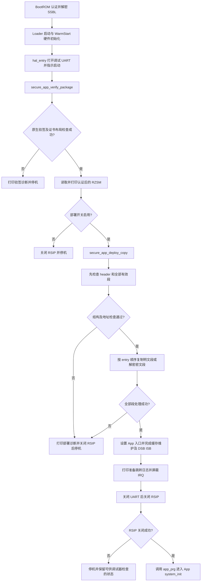

# PN2.0 Scheme A Loader 实现流程与 API 说明

## 1. 文档范围与当前方案

本文说明 PN2.0 RZ/N2L 独立 Secure SSBL Loader 在 Scheme A 下的具体实现，以及工程新增或用于该路径的接口。以当前源码为依据，不把 Scheme B 的 legacy RZAP 部署流程混入 Scheme A。

当前方案的核心是：原生 Renesas Secure Boot 证书认证完整 RZSM body；Loader 在认证成功后解析 RZSM，并将每个段复制或 AES-128-CBC 解密到对应运行地址。这里的“App 外层不加密”仅表示没有整 body 再加密；全段方案的各个有效 payload 仍然是密文。

- BootROM 负责认证并解密整镜像加密的 SSBL。
- SSBL 负责认证 App 包、检查 RZSM、部署 App 段并跳转到 App `system_init`。
- 制包脚本负责从原 App RZAP 提取有效段、生成 RZSM、计算逐段 SHA-256 和执行可选段级加密。
- 作者于 2026-10-12 确认：HyperRAM 配置下，七个有效段全部加密的方案已在 RZN2L RSK socket board 上运行成功。

本文只描述实现，不执行 IAR 编译、Flash 写入或 OTP provisioning。仓库中的 AES key 已作为公开 demo key 发布，不可用于生产设备。

### 1.1 主要源码与配套文档

| 文件 | 职责 |
| --- | --- |
| [hal_entry.c](RZN2L_bsp_xspi0bootx1_loader/src/hal_entry.c) | 启动编排、WarmStart 初始化、UART 日志、失败停机、缓存维护与 App 跳转 |
| [secure_ssbl_config.h](RZN2L_bsp_xspi0bootx1_loader/src/secure_ssbl_config.h) | Scheme、验签、部署和日志开关 |
| [secure_app_package.h](RZN2L_bsp_xspi0bootx1_loader/src/secure_app_package.h) | 固定包布局及 Flash 指针接口 |
| [secure_app_manifest.h](RZN2L_bsp_xspi0bootx1_loader/src/secure_app_manifest.h) | RZSM v2 header/entry ABI、段 ID、flags 与密钥选择值 |
| [secure_app_verify.h](RZN2L_bsp_xspi0bootx1_loader/src/secure_app_verify.h) | 验签模块公开接口、结果和诊断结构 |
| [secure_app_verify.c](RZN2L_bsp_xspi0bootx1_loader/src/secure_app_verify.c) | RSIP 打开、原生证书验签、Code Certificate 布局检查与关闭 |
| [secure_app_deploy.h](RZN2L_bsp_xspi0bootx1_loader/src/secure_app_deploy.h) | 部署模块公开接口、结果和诊断结构 |
| [secure_app_deploy.c](RZN2L_bsp_xspi0bootx1_loader/src/secure_app_deploy.c) | manifest 检查、目标白名单、段复制、CBC 解密与尾块处理 |

制包、签名及烧录命令见 [tools/make_secure_app_package.md](tools/make_secure_app_package.md)，英文版见 [tools/make_secure_app_package_en.md](tools/make_secure_app_package_en.md)。Loader/App 分离架构见 [README_loader_app_split.md](README_loader_app_split.md)。

## 2. 配置与 Flash 布局

### 2.1 关键配置

以下为配置头文件的默认值；这些开关通过 `#ifndef` 定义，构建时的外部定义可以覆盖默认值。

| 配置 | 当前头文件默认值 | 含义 |
| --- | --- | --- |
| `SSBL_CFG_SECURE_APP_SCHEME` | `SSBL_CFG_SECURE_APP_SCHEME_RZSM`，值为 1 | 选择 Scheme A |
| `SSBL_CFG_RSIP_PACKAGE_VERIFY_ENABLE` | 1 | 启用原生 App 包认证；加密部署也依赖该编译开关 |
| `SSBL_CFG_SECURE_PACKAGE_DEPLOY_ENABLE` | 1 | 验签后执行部署；关闭时验签后停机，不跳转 |
| `SSBL_CFG_DEBUG_UART_ENABLE` | 1 | 打印启动、验签和部署诊断 |
| `SSBL_CFG_LEGACY_TABLE_FALLBACK_ENABLE` | 0 | 保留的配置项；不要把它理解为验签失败后自动回退 |

`USE_HRAM` 构建使用 HyperRAM 目标窗口；不定义时，部署模块使用 SDRAM 目标窗口。验签关闭时 `hal_entry()` 存在非安全 legacy 分支，但该分支不属于本文描述的安全 Scheme A 路径，不能用于替代生产验签。

### 2.2 当前包地址

| 对象 | 地址/长度 | 说明 |
| --- | --- | --- |
| Loader parameter | Flash `0x60000000` | 独立烧录对象 |
| 加密 Secure SSBL | Flash `0x60000050` | 由 BootROM 处理，与 App 包独立 |
| 完整 Secure App 包 | Flash `0x60100050` | `SECURE_APP_PACKAGE_BASE_ADDR` |
| App Key Certificate | `0x60100050`，长度 `0xE0` | 第一份原生证书 |
| App Code Certificate | `0x60100130`，长度 `0x120` | 第二份原生证书 |
| RZSM body / manifest | `0x60100250` | 两份证书合计 `0x200` 字节之后 |
| App 入口 | RAM `0x0011A000` | 已验证样例的 `system_init` 入口；实际值来自认证后的 header |

```text
0x60100050  Key Certificate       0xE0 bytes
0x60100130  Code Certificate      0x120 bytes
0x60100250  RZSM header + entries + alignment padding + segment payloads
```

`package_size` 是 RZSM body 的长度，不包括外面的两份证书。段的实际 Flash 来源为 `SECURE_APP_PACKAGE_BODY_ADDR + entry.src_offset`，不是旧 RZAP 的链接源地址。

七个 entry 的 manifest 长度为 `64 + 7 * 96 = 736 = 0x2E0` bytes。2026-10-12 的全段样例中，段 0 密文从 body 偏移 `0x2E0` 开始，即 Flash `0x60100530`。原 App raw bin 的段 0 明文偏移 `0x100` 属于旧 RZAP 输入布局，不能直接用作新包的部署来源。

## 3. 从上电到 App 的执行流程



### 3.1 硬件准备

Loader 的启动/BSP 回调负责准备后续访问所需的硬件。`R_BSP_WarmStart(bsp_warm_start_event_t event)` 的当前实现如下：

| 事件 | 当前动作 |
| --- | --- |
| `BSP_WARM_START_RESET` | 当前分支没有额外动作 |
| `BSP_WARM_START_POST_LOADER` | 调用 `R_IOPORT_Open()`，随后执行 `bsp_qspi_quad_enable()` |
| `BSP_WARM_START_POST_C` | C 运行环境和时钟建立后，按编译条件执行 DDR 初始化；按引脚配置打开 I/O；最后初始化 HyperRAM 或 SDRAM |

`USE_HRAM` 对应 `hram_init()`，返回非 `FSP_SUCCESS` 时直接停机；另一构建路径调用 `bsp_sdram_init()`。外部 RAM 必须在向它部署 App 段之前可用。WarmStart 的 HyperRAM 失败发生在 `hal_entry()` 打开调试 UART 之前，因此可能没有后续 SSBL 启动日志。

进入 `hal_entry()` 后，当前日志配置下会使能 IRQ、打开 UART，设置启动指示，然后进入安全包处理。本文的验签和部署 API 不替调用者完成外部 RAM 初始化。

### 3.2 验签后才使用 RZSM

`hal_entry()` 首先调用 `secure_app_verify_package()`。该函数先打开 RSIP，再调用 `R_RSIP_SB_ManifestVerify()`。只有原生认证成功后，才通过 `verify_code_cert_layout()` 读取和检查 Code Certificate 布局及 RZSM 的 `package_size`。

成功返回后，`hal_entry()` 才打印 RZSM 并调用部署 API。认证失败时不会继续解析段并部署，也不会自动退回非安全启动路径。

### 3.3 RSIP 生命周期与跳转

验签成功时，RSIP 保持打开，供后面的段级 AES 解密使用。不能在验签成功与部署之间先调用 `secure_app_verify_close()`。

全部段部署成功后，`hal_entry()` 执行 DSB、状态指示和引脚访问保护，再调用 `R_BSP_CacheCleanInvalidateAll()`，执行 DSB/ISB，打印 `jump app` 日志，然后屏蔽 IRQ、关闭 UART、关闭 RSIP，最后调用 `app_prg()`。

因此 `jump app` 日志只表示准备跳转，不证明已进入 App。RSIP 关闭失败发生在 UART 关闭之后，不能只依赖串口判断该失败，应结合状态结构和调试器。

## 4. RZSM 数据结构与校验逻辑

### 4.1 Header 和 entry

RZSM magic 为 `0x4D535A52`，版本为 `0x00020000`；header 为 64 bytes，entry 为 96 bytes。头文件支持最多 16 个 entry，但当前目标白名单只覆盖下表中的已知段 ID。

| Header 字段 | 作用/当前检查 |
| --- | --- |
| `magic`、`format_version`、`header_size` | 必须匹配当前 RZSM v2 ABI |
| `segment_count` | 必须为 1 至 16 |
| `manifest_size` | 必须等于 `64 + segment_count * 96` |
| `package_size` | body 总长度；必须匹配已认证 Code Certificate 的 `img_len` |
| `payload_offset`、`payload_size` | payload 起点不得早于 manifest 或超过 body；大小必须等于剩余 body 长度 |
| `signed_region_offset`、`signed_region_size` | 当前要求为 0 和 `package_size`，覆盖完整 body |
| `entry_point` | 当前检查其位于 LDR_PRG 白名单窗口中 |
| `image_base_addr`、`app_manifest_offset` | 原 raw App 的制包追踪信息，不作为 Scheme A 段来源定位公式 |
| `package_version`、`package_flags`、`header_crc32` | 当前部署逻辑没有实现版本防回滚、flags 策略或 CRC32 重算 |

| Entry 字段 | 作用/当前检查 |
| --- | --- |
| `segment_id` | 选择目标内存白名单 |
| `flags` | 支持 ENABLE、ENCRYPTED、HASH_VALID；已启用段不能包含其他标志 |
| `src_offset` | 相对 body 的源偏移，必须位于 payload 区且来源范围合法 |
| `dst_addr` | 最终 RAM 地址，必须落在对应段 ID 的目标窗口 |
| `file_size` | 有效明文长度，必须非零 |
| `mem_size` | 当前要求等于 `file_size`；不通过此字段额外清零 BSS |
| `cipher_size` | 加密段为 `align_up(file_size, 16)`；明文段等于 `file_size` |
| `aes_key_selection` | 加密段只接受 CKEY0=1；明文段要求 NONE=0 |
| `aes_cbc_iv` | 加密段要求 16-byte IV 非全零，且不能与前面的有效加密段重复 |
| `sha256[8]` | 保存主机生成的明文 SHA-256；Loader 要求 HASH_VALID 标志，但没有逐段重算该哈希 |
| `load_attr`、`reserved` | 当前部署路径未据此实施额外策略 |

当前明文段常用 flags 为 `0x09`，加密段为 `0x0B`。虽然 ABI 定义了 ZERO_FILL，但当前有效段校验不支持该标志。

### 4.2 Code Certificate 布局检查

原生认证成功后，Scheme A 要求：

1. Code Certificate magic 为 `0x636F6463`，版本为 `0x00010000`。
2. 外层 flags 为 0，即整 App body 不再进行外层加密。
3. `load_addr` 和 `dest_addr` 都等于 `SECURE_APP_PACKAGE_BODY_ADDR`。
4. `img_len` 至少容纳 RZSM header，且 body 范围位于 xSPI Flash 窗口内。
5. `img_len` 与 RZSM header 的 `package_size` 相同。

布局符合时，将 `img_len` 保存为已验证 body 长度。此检查针对 App 包，不应套用到由 BootROM 加载至 RAM 的加密 SSBL 证书。

### 4.3 先全量检查，再开始写 RAM

`secure_app_deploy_copy()` 先调用 `secure_app_deploy_validate()`。只有它检查完全部有效 entry 并成功返回，才开始逐段写 RAM。主要检查包括：

- Header ABI、长度关系、body 地址范围和入口窗口。
- 启用段的 flags、非零长度，以及 `file_size == mem_size`。
- 加密段长度的 16-byte 对齐、计算溢出保护、CKEY0 选择、源偏移和目标地址四字节对齐、IV 非零及不重复。
- 源数据完整落在认证的 body/payload 和 Flash 窗口内；加密段以 `cipher_size` 检查来源范围。
- 目标完整落在对应 ID 的运行内存窗口内。
- 各有效段的目标 `mem_size` 范围不能重叠；相关范围计算检查加法溢出。

`validate_legacy_manifest_equivalence()` 位于 `#if 0` 中，当前不执行。Scheme A 不要求在 body 中保留 legacy RZAP，也不从 legacy RZAP 重新取部署来源。

### 4.4 目标地址白名单

下表采用左闭右开区间；地址是白名单范围，不表示每个包必须占满整个区间。

| 段 ID | 类型 | 允许的目标区间 |
| --- | --- | --- |
| 0 | LDR_PRG | `[0x0011A000, 0x00120000)` |
| 1 | LDR_DATA | `[0x00118000, 0x0011A000)` |
| 2 | VECTOR | `[0x00000000, 0x00020000)`，ATCM |
| 3 | USER_PRG | `[0x10000100, 0x10130000)` |
| 4 | USER_DATA | `[0x10000100, 0x10130000)` |
| 5 | SYSTEM_PRG | `USE_HRAM` 时 `[0x64000000, 0x64800000)` |
| 6 | SYSTEM_DATA | `USE_HRAM` 时 `[0x64000000, 0x64800000)` |
| 7 | NONCACHE | `[0x30160000, 0x30180000)` |
| 8 | SHARED_NONCACHE_BUFFER | `[0x30150000, 0x30160000)` |

未定义 `USE_HRAM` 时，SYSTEM_PRG/SYSTEM_DATA 的窗口改为 `[0x74000000, 0x74800000)`。Flash 来源窗口为 `[0x60000000, 0x64000000)`。

## 5. 段部署与全段 AES-CBC 解密

### 5.1 明文段

未设置 ENCRYPTED 标志时，调用传入的 `copy_func`，从 `body_addr + src_offset` 复制 `file_size` bytes 到 `dst_addr`。实际启动流程传入 `bsp_copy_multibyte`。

### 5.2 加密段

设置 ENCRYPTED 标志时，经 `decrypt_encrypted_segment()` 调用 `decrypt_aes_cbc()`，后者构造 `st_cip_drv_cipher_img_param_t` 并调用 FSP 底层 `R_CIP_DRV_PrcDecryptImage()`。

| 解密参数 | 当前设置 |
| --- | --- |
| `timing` | `CIP_DRV_CIPHER_TIMING_NONE` |
| `cipher_algo` | `CIP_DRV_CIPHER_ALGO_AES128` |
| `cipher_mode` | `CIP_DRV_CIPHER_MODE_CBC` |
| `key_select` | `0x00020000`，底层 CKEY0 选择编码 |
| `iv_select` | `0x00030000`，当前使用的底层 IV 选择编码 |
| `p_iv`、`iv_len` | 从 entry 复制到四字节对齐的局部 IV 数组，长度 16 bytes |
| `p_img_src`、`p_img_dst`、`img_len` | 本次密文来源、明文目标和处理长度 |

RZSM entry 中的 CKEY0 值是 1，CIP 的选择编码是 `0x00020000`，两者不是同一个字段。明文 AES key 不从包中读取，也不写入 Loader/App；部署使用板端已 provision 的 ckey0。本路径是显式解密部署，不是 OTFD。

### 5.3 CBC 尾块为什么需要特殊处理

主机使用零 padding，而不是 PKCS#7。若把补齐后的解密长度全部写入运行 RAM，可能覆盖后面的相邻段，因此实现分为两种情况：

1. `file_size` 为 16 的倍数：全部密文直接解密到最终目标，明文没有多余尾部 padding。
2. `file_size` 不是 16 的倍数：前面的完整 block 直接解密到目标，最后一个 block 解密到局部的 16-byte 临时数组，仅将有效尾字节复制到目标。

尾块单独解密时，若存在前面的密文 block，使用前一个密文 block 作为尾块 IV；只有一个 block 时，使用 entry 原始 IV。因此分两次解密仍保持正确的 CBC 链。

```text
trailing_bytes = file_size % 16
prefix_size   = cipher_size - 16

prefix: cipher[0 : prefix_size] -> destination[0 : prefix_size]
tail:   cipher[prefix_size : cipher_size] -> local 16-byte plaintext buffer
copy:   only trailing_bytes -> destination[prefix_size : file_size]
```

该方案不需要完整 App 或完整段的 RAM staging buffer，但会使用少量栈上 IV 数组、参数结构和尾块缓冲，不能表述为完全不使用临时 RAM。

例如已验证样例的 SYSTEM_DATA 长度为 257884 bytes，密文为 257888 bytes，目标区间结束于 `0x6403EF5C`，恰好也是 SYSTEM_PRG 起点。尾部 4-byte padding 必须丢弃，不能写到 SYSTEM_PRG 开头。

### 5.4 全段加密为何不需要另一套部署入口

主机 `--encrypt-all` 只是给所有启用且非空的已知段设置加密 metadata。Loader 不解析这个命令行选项，而是逐 entry 检查 ENCRYPTED 标志。

`encrypted_segment_destination_allowed()` 已改为复用 `segment_destination_allowed()`，因此七个当前有效段都可走相同的解密路径，并继续接受原有地址白名单检查。选择段加密或全部段加密，以及允许的明文/密文混合包，都使用同一个 Scheme A 部署 API。

## 6. 工程 API 分类与调用约束

本文所称 Scheme A API 是工程封装接口，不表示这些函数均为同一次修改新增，也不是 RASC 自动生成的 FSP API。`secure_app_verify_*` 和包指针接口可被其他 scheme 复用；`secure_app_deploy_copy_overall_app()` 则属于 Scheme B 兼容接口。

公开头文件定义了以下三类调用：

- 包布局读取：返回固定 Flash 指针，不做认证。
- 验签：打开 RSIP，认证完整包并检查布局，成功后保持 RSIP 打开。
- 部署：检查 RZSM，再复制或解密各段，成功后输出入口；不自行跳转。

这些模块使用全局最近状态，不是面向并发任务的可重入会话 API。调用者必须按启动顺序使用，不能把“取得指针”或“结构检查通过”当成“认证成功”。

## 7. 包布局读取 API

定义于 [secure_app_package.h](RZN2L_bsp_xspi0bootx1_loader/src/secure_app_package.h)，均为 `static inline`，无参数。

| 接口 | 返回值 | 说明 |
| --- | --- | --- |
| `const uint8_t * secure_app_key_cert_ptr(void)` | Key Certificate 指针 | 当前地址 `0x60100050`，供原生认证使用 |
| `const uint8_t * secure_app_code_cert_ptr(void)` | Code Certificate 指针 | 当前地址 `0x60100130` |
| `const secure_app_manifest_t * secure_app_manifest_ptr(void)` | RZSM manifest 指针 | 当前地址 `0x60100250`，Scheme A 在验签成功后读取 |
| `const uint8_t * secure_app_body_ptr(void)` | body 字节指针 | 与 Scheme A manifest 起点相同 |
| `const app_manifest_t * secure_app_legacy_manifest_ptr(void)` | legacy RZAP 指针 | 同一 body 地址按 RZAP 解释，供 Scheme B 使用；不得拿它解析 Scheme A 的 RZSM |

这些函数只做地址转换，无范围校验、无失败返回，也不跟踪验签状态。`secure_app_package_layout_t` 是布局描述类型，不是认证结果或 API 会话句柄。

## 8. 验签 API

定义见 [secure_app_verify.h](RZN2L_bsp_xspi0bootx1_loader/src/secure_app_verify.h)。

```c
secure_app_verify_result_t secure_app_verify_package(void);
secure_app_verify_result_t secure_app_verify_close(void);
uint32_t secure_app_verify_last_fsp_error(void);
uint32_t secure_app_verified_body_size(void);
const volatile secure_app_verify_status_t * secure_app_verify_last_status(void);
```

### 8.1 `secure_app_verify_package()`

- 输入：无参数，从固定包布局取得证书指针。
- 前提：Flash 可访问，RSIP 配置及板端信任链已准备；不能把重复调用当成幂等操作。
- 行为：清零最近 FSP 错误和已验证长度，打开 RSIP，原生验签，再检查 Code Certificate 与 RZSM body 布局。
- 成功：返回 `SECURE_APP_VERIFY_OK`，保存 body 长度，RSIP 保持打开。成功时最近阶段仍是 CODE_CERT_LAYOUT，不必已是 DONE。
- 失败：返回对应结果码。Open 失败不进入后续处理；认证或布局失败会尝试关闭 RSIP，该清理调用的失败没有单独覆盖原始失败码。
- 不负责：外部 RAM 初始化、RZSM 全部 entry 校验、段复制、AES 部署、缓存维护或跳转。

### 8.2 `secure_app_verify_close()`

- 输入：无参数，操作当前 `g_rsip_ctrl`。
- 用途：所有加密部署结束后释放 RSIP，或部署失败时清理。
- 返回：关闭成功为 `SECURE_APP_VERIFY_OK`，关闭失败为 `SECURE_APP_VERIFY_RSIP_CLOSE_FAILED`；验签编译开关关闭时返回 DISABLED。
- 状态：成功写入 DONE，失败写入 RSIP_CLOSE 阶段和 FSP 错误；会覆盖最近验签状态，所以应先记录原始失败信息。
- 约束：成功验签后不要在解密前调用；源码没有提供独立的“已打开/已关闭”幂等会话管理。

### 8.3 诊断和长度接口

| 接口 | 说明 |
| --- | --- |
| `secure_app_verify_last_fsp_error()` | 返回保存的最近 FSP 错误码；下一次 verify 会清零，布局检查失败可能返回 0，需要结合 result/stage 判断 |
| `secure_app_verify_last_status()` | 返回全局只读 volatile 状态指针，用于 UART 或调试器查看，不返回状态副本 |
| `secure_app_verified_body_size()` | 返回认证及布局检查后保存的 `img_len`；一次新 verify 开始时为 0，调用 close 不清零它，不能单独作为当前会话认证凭据 |

### 8.4 验签结果码

| 结果码 | 数值 | 含义 |
| --- | ---: | --- |
| `SECURE_APP_VERIFY_OK` | 0 | 调用成功 |
| `SECURE_APP_VERIFY_DISABLED` | 1 | 编译时禁用验签 |
| `SECURE_APP_VERIFY_RSIP_OPEN_FAILED` | 2 | RSIP Open 失败 |
| `SECURE_APP_VERIFY_AUTH_FAILED` | 3 | 原生 ManifestVerify 失败 |
| `SECURE_APP_VERIFY_CODE_CERT_LAYOUT_FAILED` | 4 | 已认证证书/body 布局不符合当前方案 |
| `SECURE_APP_VERIFY_RSIP_CLOSE_FAILED` | 5 | RSIP Close 失败 |

## 9. 部署 API

定义见 [secure_app_deploy.h](RZN2L_bsp_xspi0bootx1_loader/src/secure_app_deploy.h)。

```c
secure_app_deploy_result_t secure_app_deploy_validate(const secure_app_manifest_t * manifest);

secure_app_deploy_result_t secure_app_deploy_copy(const secure_app_manifest_t * manifest,
                                                  void (*copy_func)(uintptr_t * src,
                                                                    uintptr_t * dst,
                                                                    uintptr_t bytesize),
                                                  void (** p_entry)(void));

const volatile secure_app_deploy_status_t * secure_app_deploy_last_status(void);
```

### 9.1 `secure_app_deploy_validate()`

- `manifest`：已认证 RZSM body 的指针，通常来自 `secure_app_manifest_ptr()`。
- 行为：执行第 4 节的 header、entry、来源范围、目标白名单、加密 metadata 和目标重叠检查。
- 返回：成功为 `SECURE_APP_DEPLOY_OK`；失败为对应部署结果，并写入最近诊断状态。
- 副作用：更新诊断结构，但不复制或解密段，不关闭 RSIP，不跳转。
- 调用约束：它不调用原生验签，也不检查全局认证状态。调用者必须先确认 `secure_app_verify_package()` 成功。

### 9.2 `secure_app_deploy_copy()`

| 参数 | 说明 |
| --- | --- |
| `manifest` | 已认证 RZSM manifest；内部首先调用 `secure_app_deploy_validate()` |
| `copy_func` | 明文段复制回调；实际使用 `bsp_copy_multibyte`，即使全部段加密也不能传 NULL |
| `p_entry` | 输出函数指针的地址；实际传入 `&app_prg`，不能传 NULL |

函数先验证全部段，再按 entry 顺序部署。全部完成后才设置 `*p_entry = manifest->header.entry_point`，写入 DONE 阶段并返回 OK。

任一段解密失败都会返回 `SECURE_APP_DEPLOY_ERR_ENCRYPTED_SEGMENT`。此前的段或当前段的前缀可能已经写入 RAM；没有事务回滚。失败时不能使用输出入口，更不能跳转。

回调返回类型是 `void`，部署 API 不能从回调返回值获知复制错误；调用者必须提供正确的同步复制实现。函数不执行缓存维护、不关闭 RSIP、不屏蔽 IRQ，也不实际调用 App。

### 9.3 `secure_app_deploy_last_status()`

返回全局只读 volatile 部署状态指针。应结合 `result`、`stage`、段索引/ID、地址、大小和 `detail` 判断失败位置，不应只看函数返回码。

### 9.4 Scheme B 兼容接口

`secure_app_deploy_copy_overall_app()` 接受 legacy RZAP 指针、原 image 链接基址、运行来源基址、已认证 body 长度、复制回调和入口输出参数。它属于 overall-app/Scheme B，不是全段加密 Scheme A 的另一个入口。Scheme A 应使用 `secure_app_deploy_copy()`。

### 9.5 部署结果码

| 结果码 | 数值 | 含义 |
| --- | ---: | --- |
| `SECURE_APP_DEPLOY_OK` | 0 | 校验或部署成功 |
| `SECURE_APP_DEPLOY_ERR_NULL` | 1 | 必需指针/回调为空 |
| `SECURE_APP_DEPLOY_ERR_HEADER` | 2 | RZSM header 不符合 ABI 或长度关系 |
| `SECURE_APP_DEPLOY_ERR_PACKAGE_RANGE` | 3 | 包范围非法 |
| `SECURE_APP_DEPLOY_ERR_SEGMENT_RANGE` | 4 | 段来源或目标范围非法 |
| `SECURE_APP_DEPLOY_ERR_SEGMENT_FLAGS` | 5 | flags、大小关系或加密 metadata 非法 |
| `SECURE_APP_DEPLOY_ERR_SEGMENT_OVERLAP` | 6 | 目标段范围重叠 |
| `SECURE_APP_DEPLOY_ERR_LEGACY_MISMATCH` | 7 | legacy 相关错误码；Scheme A 的旧 equivalence 检查当前未启用 |
| `SECURE_APP_DEPLOY_ERR_ENTRY_POINT` | 8 | 入口不在允许窗口 |
| `SECURE_APP_DEPLOY_ERR_ENCRYPTED_SEGMENT` | 9 | 实际解密失败，或编译配置不支持加密处理 |

## 10. 内部函数与 FSP 原生接口

以下内部函数为 `static` 实现细节，不应当作应用层可链接的公开 API。

| 内部函数 | 模块 | 作用 |
| --- | --- | --- |
| `verify_code_cert_layout()` | verify | 认证后检查证书地址、长度及外层非加密要求 |
| `verify_status_set()` | verify | 写入验签诊断 |
| `manifest_verify_error_string()` | verify | 将 FSP ManifestVerify 错误映射为日志文本 |
| `validate_header()` | deploy | 检查 RZSM header 及包范围 |
| `segment_destination_allowed()` | deploy | 按段 ID 检查目标白名单 |
| `encrypted_segment_destination_allowed()` | deploy | 对加密段复用同一白名单 |
| `segment_payload_size()`、`segment_source_allowed()` | deploy | 选择来源长度并检查来源范围 |
| `range_inside()` | verify/deploy 各自定义 | 检查区间包含关系和加法溢出 |
| `segments_overlap()`、`later_enabled_segments_overlap()` | deploy | 检查目标重叠 |
| `cbc_iv_is_zero()`、`encrypted_iv_is_reused()` | deploy | 检查 IV 全零及重复 |
| `decrypt_aes_cbc()` | deploy | 构造 CIP 参数并执行一次 AES-CBC 解密 |
| `decrypt_encrypted_segment()` | deploy | 处理直接解密、前缀解密及尾块安全复制 |
| `deploy_status_set()` | deploy | 写入部署诊断 |

| 底层接口 | 在本流程中的调用方式/责任 |
| --- | --- |
| `R_RSIP_Open(&g_rsip_ctrl, &g_rsip_cfg)` | 初始化并打开 RSIP；返回 `fsp_err_t` |
| `R_RSIP_SB_ManifestVerify(...)` | 输入控制块、Key Certificate 指针及长度、Code Certificate 指针及长度；认证原生证书和它描述的完整 App image |
| `R_CIP_DRV_PrcDecryptImage(&decrypt_param)` | 使用 CIP 参数执行段级 AES 解密；PASS 才能继续；属于 FSP 底层接口而非本工程新生成 API |
| `R_RSIP_Close(&g_rsip_ctrl)` | 部署后关闭 RSIP；关闭失败禁止最终跳转 |
| `bsp_copy_multibyte(...)` | 工程已有的同步段复制实现，不是验签函数 |
| `R_BSP_CacheCleanInvalidateAll()` | 由 `hal_entry()` 在部署后执行缓存维护 |

## 11. 状态字段与排错

### 11.1 验签状态

`secure_app_verify_status_t` 包含 `result`、`stage`、`fsp_error`、`key_cert_addr`、`code_cert_addr`、`key_cert_size` 和 `code_cert_size`。全局变量为 `g_secure_app_verify_last_status`，调试器可直接观察。

阶段编号依次为：IDLE=0、RSIP_OPEN=1、MANIFEST_VERIFY=2、CODE_CERT_LAYOUT=3、RSIP_CLOSE=4、DONE=5。其中 result=0 才表示成功；stage 表示最近执行位置，不是独立成功判据。

### 11.2 部署状态

`secure_app_deploy_status_t` 包含以下字段；全局变量为 `g_secure_app_deploy_last_status`。

| 字段 | 含义 |
| --- | --- |
| `result` | 部署结果码 |
| `stage` | 最近检查/执行阶段 |
| `segment_index` | manifest 数组中的索引，不保证等于段 ID；成功 DONE 时写入 segment_count |
| `segment_id` | 逻辑段 ID |
| `address`、`size` | 当前阶段相关的地址和长度，不是所有阶段都表示同一种对象 |
| `detail` | 阶段相关细节；可能是 flags、密钥选择、内部检查编号或 CIP 返回值 |

阶段编号依次为：IDLE=0、HEADER=1、PACKAGE_RANGE=2、ENTRY_POINT=3、LEGACY_MANIFEST=4、SEGMENT_FLAGS=5、SEGMENT_SOURCE=6、SEGMENT_DESTINATION=7、SEGMENT_OVERLAP=8、SEGMENT_CRYPTO=9、COPY=10、DONE=11。

实际 CIP 解密失败通常表现为 result=9、stage=9，`detail` 保存 CIP 错误值；加密 metadata 检查失败可能是 result=5、stage=9，不能把两者混为同一个问题。

### 11.3 建议排查顺序

1. 没有 Loader 日志：先检查 BootROM 启动、SSBL 包、地址和 UART，而不是修改 App entry。
2. VERIFY 失败：检查完整 App 包、信任链、Flash 内容以及原生 FSP 错误。
3. CODE_CERT_LAYOUT 失败：检查外层是否误加 `--enckey`，以及 body 地址和 `img_len/package_size` 是否一致。
4. DEPLOY 检查失败：结合 stage 检查 ABI、段 flags、来源、目标、重叠及 IV。
5. SEGMENT_CRYPTO 执行失败：检查 ckey0、CIP 返回值、IV、地址对齐和外部 RAM 准备状态。
6. 出现 `jump app` 但应用不运行：检查关闭阶段、真实入口、App startup 和运行数据；不要把日志当作跳转完成证据。

## 12. 安全边界与 App 配合事项

### 12.1 当前实现已经做什么

原生验签保护的是包含 RZSM metadata 和各段 payload 的完整 body；目的地址、IV、长度和入口均位于该认证对象内。之后的结构和地址校验负责限制部署行为。全段加密仍沿用同一安全边界和白名单，不是取消地址检查后直接写任意 RAM。

### 12.2 不应从现有字段推导出的功能

- HASH_VALID 和 `sha256` 字段不意味着 Loader 已逐段做明文哈希校验；当前逐段 SHA/CBC/零 padding 比较在主机工具中完成。
- 当前 Loader 不对解密输出的零 padding 逐字节检查；它通过尾块逻辑不把 padding 写入运行区。
- `package_version`、证书 `img_version`/`build_num` 的存在不表示本工程已实现单调版本防回滚。
- 当前 header 入口检查是 LDR_PRG 窗口检查，不是“入口一定包含于某个实际部署的 LDR_PRG 段”的完整证明。
- 当前 Scheme A 校验没有专门实施必需段集合和重复段 ID 检查；正常包由主机生成器约束。不要把白名单检查描述为全部语义策略已经完备。
- API 使用固定 Flash body 地址；不能直接给另一个 bank 的 manifest 指针，就假定部署源地址也自动切换。
- 当前启动流程没有实现双 bank 选择、失败自动回退、完整更新事务或掉电恢复；这些属于后续安全更新设计。

### 12.3 与 App startup 的配合

SSBL 已经把初始化数据部署到运行地址。集成启动时 App 不应再按旧 raw App Flash 地址重复搬运 LDR_DATA，否则可能覆盖 SSBL 刚部署的数据。

当前 App 在 [startup.c](RZN2L_bsp_xspi0bootx1_app/src/fsp_mod/startup.c) 中用 `APP_STANDALONE_DEBUG` 控制 `bsp_loader_data_init()`。独立调试可保留需要的数据初始化路径，集成启动则避免旧来源重复复制；BSS 初始化与后续 App 初始化仍需保留。

最终入口是 App `system_init`，不是直接跳 `main`。这样才能继续执行 App 的 MPU/运行环境、BSS、构造函数和后续应用/FreeRTOS 启动步骤。

## 13. 阅读与复现顺序

1. 先读本文第 2、3 节，区分 SSBL 和 App 的两条信任链，以及三个 Flash 对象的地址。
2. 再对照 `hal_entry()` 和第 8、9 节理解 API 调用顺序，尤其是 RSIP 必须保留到解密结束。
3. 用第 4、5 节理解 manifest 的来源偏移、目标白名单及 CBC 尾块处理。
4. 实际生成/签名包时，使用 [tools/make_secure_app_package.md](tools/make_secure_app_package.md) 第 11 节的全段命令及匹配的新 Loader 产物。
5. 用 UART、诊断状态和 App 运行证据验证启动；需要逐字节确认时，在 App 修改 RAM 前回读各段，而不是只检查 `DEPLOY OK` 或 `jump app` 日志。
