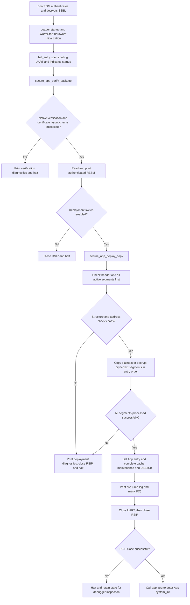

# PN2.0 Scheme A Loader Implementation Flow and API Guide

## 1. Document Scope and Current Scheme

This document describes the implementation of the standalone PN2.0 RZ/N2L Secure SSBL Loader under Scheme A, together with the interfaces added to the project or used by this path. It is based on the current source code and does not mix the Scheme B legacy RZAP deployment flow into Scheme A.

The core of the current scheme is that native Renesas Secure Boot certificates authenticate the complete RZSM body. After successful authentication, the Loader parses RZSM and copies or AES-128-CBC decrypts each segment to its runtime address. Here, "no outer App encryption" only means that the entire body is not encrypted again as a whole; each active payload in the all-segment scheme is still ciphertext.

- BootROM authenticates and decrypts the SSBL, which uses whole-image encryption.
- SSBL authenticates the App package, checks RZSM, deploys the App segments, and jumps to the App `system_init`.
- The packaging script extracts active segments from the original App RZAP, generates RZSM, computes per-segment SHA-256, and performs optional segment-level encryption.
- On 2026-10-12, the author confirmed that the scheme encrypting all seven active segments ran successfully on the RZN2L RSK socket board with HyperRAM configured.

This document describes the implementation only; it does not perform IAR builds, Flash writes, or OTP provisioning. The AES key in the repository has been published as a public demo key and must not be used in production devices.

### 1.1 Main Source Files and Related Documents

| File | Responsibility |
| --- | --- |
| [hal_entry.c](RZN2L_bsp_xspi0bootx1_loader/src/hal_entry.c) | Boot orchestration, WarmStart initialization, UART logging, failure halt, cache maintenance, and App jump |
| [secure_ssbl_config.h](RZN2L_bsp_xspi0bootx1_loader/src/secure_ssbl_config.h) | Scheme, verification, deployment, and logging switches |
| [secure_app_package.h](RZN2L_bsp_xspi0bootx1_loader/src/secure_app_package.h) | Fixed package layout and Flash pointer interfaces |
| [secure_app_manifest.h](RZN2L_bsp_xspi0bootx1_loader/src/secure_app_manifest.h) | RZSM v2 header/entry ABI, segment IDs, flags, and key selection values |
| [secure_app_verify.h](RZN2L_bsp_xspi0bootx1_loader/src/secure_app_verify.h) | Public verification interfaces, results, and diagnostic structures |
| [secure_app_verify.c](RZN2L_bsp_xspi0bootx1_loader/src/secure_app_verify.c) | RSIP open, native certificate verification, Code Certificate layout checks, and close |
| [secure_app_deploy.h](RZN2L_bsp_xspi0bootx1_loader/src/secure_app_deploy.h) | Public deployment interfaces, results, and diagnostic structures |
| [secure_app_deploy.c](RZN2L_bsp_xspi0bootx1_loader/src/secure_app_deploy.c) | Manifest checks, destination allowlists, segment copying, CBC decryption, and final-block handling |

For packaging, signing, and programming commands, see [tools/make_secure_app_package.md](tools/make_secure_app_package.md), or its English version, [tools/make_secure_app_package_en.md](tools/make_secure_app_package_en.md). For the Loader/App split architecture, see [README_loader_app_split.md](README_loader_app_split.md).

## 2. Configuration and Flash Layout

### 2.1 Key Configuration

The following values are defaults in the configuration header. These switches are defined through `#ifndef`, so external build-time definitions can override the defaults.

| Configuration | Current Header Default | Meaning |
| --- | --- | --- |
| `SSBL_CFG_SECURE_APP_SCHEME` | `SSBL_CFG_SECURE_APP_SCHEME_RZSM`, value 1 | Select Scheme A |
| `SSBL_CFG_RSIP_PACKAGE_VERIFY_ENABLE` | 1 | Enable native App package authentication; encrypted deployment also depends on this compile-time switch |
| `SSBL_CFG_SECURE_PACKAGE_DEPLOY_ENABLE` | 1 | Deploy after verification; when disabled, halt after verification without jumping |
| `SSBL_CFG_DEBUG_UART_ENABLE` | 1 | Print boot, verification, and deployment diagnostics |
| `SSBL_CFG_LEGACY_TABLE_FALLBACK_ENABLE` | 0 | Reserved configuration item; do not interpret it as automatic fallback after verification failure |

A `USE_HRAM` build uses the HyperRAM destination window; otherwise, the deployment module uses the SDRAM destination window. When verification is disabled, `hal_entry()` has a non-secure legacy branch, but that branch is outside the secure Scheme A path described here and cannot replace production verification.

### 2.2 Current Package Addresses

| Object | Address/Length | Description |
| --- | --- | --- |
| Loader parameter | Flash `0x60000000` | Separately programmed object |
| Encrypted Secure SSBL | Flash `0x60000050` | Handled by BootROM, independently of the App package |
| Complete Secure App package | Flash `0x60100050` | `SECURE_APP_PACKAGE_BASE_ADDR` |
| App Key Certificate | `0x60100050`, length `0xE0` | First native certificate |
| App Code Certificate | `0x60100130`, length `0x120` | Second native certificate |
| RZSM body / manifest | `0x60100250` | After the two certificates, totaling `0x200` bytes |
| App entry point | RAM `0x0011A000` | `system_init` entry in the verified example; the actual value comes from the authenticated header |

```text
0x60100050  Key Certificate       0xE0 bytes
0x60100130  Code Certificate      0x120 bytes
0x60100250  RZSM header + entries + alignment padding + segment payloads
```

`package_size` is the length of the RZSM body, excluding the two outer certificates. The actual Flash source of a segment is `SECURE_APP_PACKAGE_BODY_ADDR + entry.src_offset`, not the link-time source address in the old RZAP.

For seven entries, the manifest length is `64 + 7 * 96 = 736 = 0x2E0` bytes. In the all-segment example dated 2026-10-12, segment 0 ciphertext starts at body offset `0x2E0`, corresponding to Flash `0x60100530`. The segment 0 plaintext offset `0x100` in the original App raw bin belongs to the old RZAP input layout and cannot be used directly as the deployment source for the new package.

## 3. Execution Flow from Power-On to the App



### 3.1 Hardware Preparation

The Loader startup/BSP callbacks prepare the hardware required for subsequent access. The current implementation of `R_BSP_WarmStart(bsp_warm_start_event_t event)` is as follows:

| Event | Current Action |
| --- | --- |
| `BSP_WARM_START_RESET` | No additional action in the current branch |
| `BSP_WARM_START_POST_LOADER` | Call `R_IOPORT_Open()`, then execute `bsp_qspi_quad_enable()` |
| `BSP_WARM_START_POST_C` | After the C runtime and clocks are established, initialize DDR according to build conditions, open I/O according to the pin configuration, and finally initialize HyperRAM or SDRAM |

`USE_HRAM` selects `hram_init()`, which halts immediately if it returns anything other than `FSP_SUCCESS`; the other build path calls `bsp_sdram_init()`. External RAM must be available before App segments are deployed into it. A HyperRAM failure in WarmStart occurs before `hal_entry()` opens the debug UART, so subsequent SSBL startup logs may be absent.

After entering `hal_entry()`, the current logging configuration enables IRQ, opens UART, sets the startup indication, and then begins secure package processing. The verification and deployment APIs described here do not initialize external RAM on behalf of the caller.

### 3.2 Use RZSM Only After Verification

`hal_entry()` first calls `secure_app_verify_package()`. This function opens RSIP, then calls `R_RSIP_SB_ManifestVerify()`. Only after native authentication succeeds does `verify_code_cert_layout()` read and check the Code Certificate layout and the RZSM `package_size`.

Only after a successful return does `hal_entry()` print RZSM and call the deployment API. Authentication failure prevents further segment parsing and deployment; it does not automatically fall back to a non-secure boot path.

### 3.3 RSIP Lifecycle and Jump

After successful verification, RSIP remains open for subsequent segment-level AES decryption. Do not call `secure_app_verify_close()` between successful verification and deployment.

After all segments are deployed successfully, `hal_entry()` performs DSB, status indication, and pin access protection, then calls `R_BSP_CacheCleanInvalidateAll()`, executes DSB/ISB, prints the `jump app` log, masks IRQ, closes UART, closes RSIP, and finally calls `app_prg()`.

Therefore, the `jump app` log only indicates preparation for the jump; it does not prove that the App has been entered. An RSIP close failure occurs after UART is closed, so serial output alone cannot identify this failure. Inspect the status structure and debugger as well.

## 4. RZSM Data Structures and Validation Logic

### 4.1 Header and Entries

The RZSM magic is `0x4D535A52`, and the version is `0x00020000`; the header is 64 bytes and each entry is 96 bytes. The header definitions support up to 16 entries, but the current destination allowlist covers only the known segment IDs in the table below.

| Header Field | Purpose/Current Check |
| --- | --- |
| `magic`, `format_version`, `header_size` | Must match the current RZSM v2 ABI |
| `segment_count` | Must be from 1 to 16 |
| `manifest_size` | Must equal `64 + segment_count * 96` |
| `package_size` | Total body length; must match `img_len` in the authenticated Code Certificate |
| `payload_offset`, `payload_size` | Payload start must not precede the manifest or exceed the body; size must equal the remaining body length |
| `signed_region_offset`, `signed_region_size` | Currently required to be 0 and `package_size`, covering the complete body |
| `entry_point` | Currently checked to be inside the LDR_PRG allowlisted window |
| `image_base_addr`, `app_manifest_offset` | Packaging traceability information for the original raw App; not used in the Scheme A segment source address formula |
| `package_version`, `package_flags`, `header_crc32` | Current deployment logic does not implement version anti-rollback, a flags policy, or CRC32 recomputation |

| Entry Field | Purpose/Current Check |
| --- | --- |
| `segment_id` | Selects the destination memory allowlist |
| `flags` | Supports ENABLE, ENCRYPTED, and HASH_VALID; enabled segments must not contain other flags |
| `src_offset` | Source offset relative to the body; must be in the payload area with a valid source range |
| `dst_addr` | Final RAM address; must fall within the destination window for the segment ID |
| `file_size` | Valid plaintext length; must be nonzero |
| `mem_size` | Currently required to equal `file_size`; this field does not trigger additional BSS zeroing |
| `cipher_size` | `align_up(file_size, 16)` for encrypted segments; `file_size` for plaintext segments |
| `aes_key_selection` | Encrypted segments accept only CKEY0=1; plaintext segments require NONE=0 |
| `aes_cbc_iv` | Encrypted segments require a nonzero 16-byte IV that does not duplicate any preceding active encrypted segment's IV |
| `sha256[8]` | Stores the host-generated plaintext SHA-256; the Loader requires HASH_VALID but does not recompute this hash per segment |
| `load_attr`, `reserved` | The current deployment path does not implement additional policies based on these fields |

Typical current flags are `0x09` for plaintext segments and `0x0B` for encrypted segments. Although the ABI defines ZERO_FILL, current active-segment validation does not support that flag.

### 4.2 Code Certificate Layout Checks

After successful native authentication, Scheme A requires:

1. Code Certificate magic `0x636F6463` and version `0x00010000`.
2. Outer flags of 0, meaning that the entire App body has no additional outer encryption.
3. Both `load_addr` and `dest_addr` equal to `SECURE_APP_PACKAGE_BODY_ADDR`.
4. `img_len` large enough to contain the RZSM header, with the body range inside the xSPI Flash window.
5. `img_len` equal to `package_size` in the RZSM header.

When the layout is valid, `img_len` is saved as the verified body length. These checks apply to the App package, not to the encrypted SSBL certificate whose image BootROM loads into RAM.

### 4.3 Validate Everything Before Writing RAM

`secure_app_deploy_copy()` first calls `secure_app_deploy_validate()`. It starts writing RAM segment by segment only after validation has checked all active entries and returned successfully. The main checks include:

- Header ABI, length relationships, body address range, and entry-point window.
- Flags, nonzero lengths, and `file_size == mem_size` for enabled segments.
- Encrypted length alignment to 16 bytes, arithmetic overflow protection, CKEY0 selection, four-byte alignment of source offsets and destination addresses, and nonzero, non-reused IVs.
- Source data entirely within the authenticated body/payload and Flash window; encrypted source ranges are checked using `cipher_size`.
- Destinations entirely within the runtime memory window for the corresponding ID.
- No overlap among the destination `mem_size` ranges of active segments; related range calculations check for addition overflow.

`validate_legacy_manifest_equivalence()` is inside `#if 0` and is not currently executed. Scheme A does not require legacy RZAP to be retained in the body and does not retrieve deployment sources from legacy RZAP again.

### 4.4 Destination Address Allowlist

The following table uses half-open intervals: the lower bound is inclusive and the upper bound is exclusive. These are allowlisted ranges, not a requirement that every package occupy the full interval.

| Segment ID | Type | Allowed Destination Interval |
| --- | --- | --- |
| 0 | LDR_PRG | `[0x0011A000, 0x00120000)` |
| 1 | LDR_DATA | `[0x00118000, 0x0011A000)` |
| 2 | VECTOR | `[0x00000000, 0x00020000)`, ATCM |
| 3 | USER_PRG | `[0x10000100, 0x10130000)` |
| 4 | USER_DATA | `[0x10000100, 0x10130000)` |
| 5 | SYSTEM_PRG | `[0x64000000, 0x64800000)` with `USE_HRAM` |
| 6 | SYSTEM_DATA | `[0x64000000, 0x64800000)` with `USE_HRAM` |
| 7 | NONCACHE | `[0x30160000, 0x30180000)` |
| 8 | SHARED_NONCACHE_BUFFER | `[0x30150000, 0x30160000)` |

Without `USE_HRAM`, the SYSTEM_PRG/SYSTEM_DATA window changes to `[0x74000000, 0x74800000)`. The Flash source window is `[0x60000000, 0x64000000)`.

## 5. Segment Deployment and All-Segment AES-CBC Decryption

### 5.1 Plaintext Segments

When ENCRYPTED is not set, the supplied `copy_func` copies `file_size` bytes from `body_addr + src_offset` to `dst_addr`. The actual boot flow supplies `bsp_copy_multibyte`.

### 5.2 Encrypted Segments

When ENCRYPTED is set, `decrypt_encrypted_segment()` calls `decrypt_aes_cbc()`, which constructs `st_cip_drv_cipher_img_param_t` and calls the low-level FSP interface `R_CIP_DRV_PrcDecryptImage()`.

| Decryption Parameter | Current Setting |
| --- | --- |
| `timing` | `CIP_DRV_CIPHER_TIMING_NONE` |
| `cipher_algo` | `CIP_DRV_CIPHER_ALGO_AES128` |
| `cipher_mode` | `CIP_DRV_CIPHER_MODE_CBC` |
| `key_select` | `0x00020000`, the low-level CKEY0 selection encoding |
| `iv_select` | `0x00030000`, the low-level IV selection encoding currently used |
| `p_iv`, `iv_len` | Copied from the entry to a four-byte-aligned local IV array, length 16 bytes |
| `p_img_src`, `p_img_dst`, `img_len` | Ciphertext source, plaintext destination, and processing length for this operation |

The CKEY0 value in an RZSM entry is 1, whereas the CIP selection encoding is `0x00020000`; these are different fields. The plaintext AES key is neither read from the package nor written into the Loader/App; deployment uses ckey0 already provisioned on the board. This path performs explicit decryption during deployment, not OTFD.

### 5.3 Why the Final CBC Block Needs Special Handling

The host uses zero padding, not PKCS#7. Writing the entire padded decryption length to runtime RAM could overwrite an adjacent segment, so the implementation handles two cases:

1. `file_size` is a multiple of 16: decrypt all ciphertext directly to the final destination; the plaintext has no extra trailing padding.
2. `file_size` is not a multiple of 16: decrypt the preceding full blocks directly to the destination, decrypt the final block to a local 16-byte temporary array, and copy only the valid trailing bytes to the destination.

When decrypting the final block separately, use the preceding ciphertext block as its IV if a preceding block exists; for a single-block segment, use the original entry IV. Thus, two decryption operations still preserve the correct CBC chain.

```text
trailing_bytes = file_size % 16
prefix_size   = cipher_size - 16

prefix: cipher[0 : prefix_size] -> destination[0 : prefix_size]
tail:   cipher[prefix_size : cipher_size] -> local 16-byte plaintext buffer
copy:   only trailing_bytes -> destination[prefix_size : file_size]
```

This scheme does not need a RAM staging buffer for the entire App or an entire segment. It does use small stack-based IV arrays, parameter structures, and a final-block buffer, so it must not be described as using no temporary RAM at all.

For example, SYSTEM_DATA in the verified example is 257884 bytes long, with 257888 bytes of ciphertext. Its destination interval ends at `0x6403EF5C`, which is also the start of SYSTEM_PRG. The trailing 4-byte padding must be discarded, not written over the beginning of SYSTEM_PRG.

### 5.4 Why All-Segment Encryption Needs No Separate Deployment Entry Point

The host option `--encrypt-all` simply sets encryption metadata for all enabled, nonempty known segments. The Loader does not parse this command-line option; it checks ENCRYPTED entry by entry.

`encrypted_segment_destination_allowed()` has been changed to reuse `segment_destination_allowed()`, allowing all seven currently active segments to use the same decryption path while retaining the existing destination allowlist checks. Selective encryption, all-segment encryption, and permitted mixed plaintext/ciphertext packages all use the same Scheme A deployment API.

## 6. Project API Categories and Calling Constraints

The Scheme A APIs described here are project wrapper interfaces. This does not mean that all these functions were introduced in the same change, nor are they RASC-generated FSP APIs. `secure_app_verify_*` and the package pointer interfaces can be reused by other schemes; `secure_app_deploy_copy_overall_app()` is a Scheme B compatibility interface.

The public headers define three categories of calls:

- Package layout access: returns fixed Flash pointers without authentication.
- Verification: opens RSIP, authenticates the complete package, checks the layout, and leaves RSIP open on success.
- Deployment: checks RZSM, then copies or decrypts each segment and outputs the entry point on success; it does not jump by itself.

These modules use global last-status data and are not reentrant session APIs designed for concurrent tasks. The caller must follow the boot sequence and must not equate "obtaining a pointer" or "passing structural checks" with "successful authentication."

## 7. Package Layout Access APIs

Defined in [secure_app_package.h](RZN2L_bsp_xspi0bootx1_loader/src/secure_app_package.h); all are `static inline` and take no arguments.

| Interface | Return Value | Description |
| --- | --- | --- |
| `const uint8_t * secure_app_key_cert_ptr(void)` | Key Certificate pointer | Current address `0x60100050`, used for native authentication |
| `const uint8_t * secure_app_code_cert_ptr(void)` | Code Certificate pointer | Current address `0x60100130` |
| `const secure_app_manifest_t * secure_app_manifest_ptr(void)` | RZSM manifest pointer | Current address `0x60100250`; Scheme A reads it after successful verification |
| `const uint8_t * secure_app_body_ptr(void)` | Body byte pointer | Same as the Scheme A manifest start |
| `const app_manifest_t * secure_app_legacy_manifest_ptr(void)` | Legacy RZAP pointer | Interprets the same body address as RZAP for Scheme B; must not be used to parse Scheme A RZSM |

These functions only cast addresses. They perform no range validation, have no failure return, and do not track verification state. `secure_app_package_layout_t` is a layout description type, not an authentication result or an API session handle.

## 8. Verification APIs

For definitions, see [secure_app_verify.h](RZN2L_bsp_xspi0bootx1_loader/src/secure_app_verify.h).

```c
secure_app_verify_result_t secure_app_verify_package(void);
secure_app_verify_result_t secure_app_verify_close(void);
uint32_t secure_app_verify_last_fsp_error(void);
uint32_t secure_app_verified_body_size(void);
const volatile secure_app_verify_status_t * secure_app_verify_last_status(void);
```

### 8.1 `secure_app_verify_package()`

- Input: no arguments; obtains certificate pointers from the fixed package layout.
- Preconditions: Flash is accessible, and the RSIP configuration and board trust chain are ready; repeated calls must not be treated as idempotent operations.
- Behavior: clears the last FSP error and verified length, opens RSIP, performs native verification, and then checks the Code Certificate and RZSM body layout.
- Success: returns `SECURE_APP_VERIFY_OK`, saves the body length, and leaves RSIP open. The last stage on success remains CODE_CERT_LAYOUT; it need not already be DONE.
- Failure: returns the corresponding result code. An Open failure prevents subsequent processing; authentication or layout failure triggers an attempt to close RSIP, and a failure of that cleanup call does not separately replace the original failure code.
- Not responsible for: external RAM initialization, validation of all RZSM entries, segment copying, AES deployment, cache maintenance, or jumping.

### 8.2 `secure_app_verify_close()`

- Input: no arguments; operates on the current `g_rsip_ctrl`.
- Purpose: releases RSIP after all encrypted deployment operations finish, or cleans up after deployment failure.
- Return: `SECURE_APP_VERIFY_OK` on successful close, `SECURE_APP_VERIFY_RSIP_CLOSE_FAILED` on close failure, and DISABLED when the verification compile-time switch is disabled.
- Status: sets DONE on success, or the RSIP_CLOSE stage and FSP error on failure. It overwrites the last verification status, so record the original failure information first.
- Constraint: after successful verification, do not call it before decryption; the source provides no separate idempotent "open/closed" session management.

### 8.3 Diagnostic and Length Interfaces

| Interface | Description |
| --- | --- |
| `secure_app_verify_last_fsp_error()` | Returns the saved last FSP error code; the next verify clears it. A layout check failure may return 0, so also inspect result/stage |
| `secure_app_verify_last_status()` | Returns a global read-only volatile status pointer for UART or debugger inspection, not a status copy |
| `secure_app_verified_body_size()` | Returns `img_len` saved after authentication and layout checks; it is 0 at the start of a new verify, and close does not clear it. It cannot serve alone as proof of authentication for the current session |

### 8.4 Verification Result Codes

| Result Code | Value | Meaning |
| --- | ---: | --- |
| `SECURE_APP_VERIFY_OK` | 0 | Call succeeded |
| `SECURE_APP_VERIFY_DISABLED` | 1 | Verification disabled at compile time |
| `SECURE_APP_VERIFY_RSIP_OPEN_FAILED` | 2 | RSIP Open failed |
| `SECURE_APP_VERIFY_AUTH_FAILED` | 3 | Native ManifestVerify failed |
| `SECURE_APP_VERIFY_CODE_CERT_LAYOUT_FAILED` | 4 | Authenticated certificate/body layout does not match the current scheme |
| `SECURE_APP_VERIFY_RSIP_CLOSE_FAILED` | 5 | RSIP Close failed |

## 9. Deployment APIs

For definitions, see [secure_app_deploy.h](RZN2L_bsp_xspi0bootx1_loader/src/secure_app_deploy.h).

```c
secure_app_deploy_result_t secure_app_deploy_validate(const secure_app_manifest_t * manifest);

secure_app_deploy_result_t secure_app_deploy_copy(const secure_app_manifest_t * manifest,
                                                  void (*copy_func)(uintptr_t * src,
                                                                    uintptr_t * dst,
                                                                    uintptr_t bytesize),
                                                  void (** p_entry)(void));

const volatile secure_app_deploy_status_t * secure_app_deploy_last_status(void);
```

### 9.1 `secure_app_deploy_validate()`

- `manifest`: pointer to the authenticated RZSM body, normally obtained from `secure_app_manifest_ptr()`.
- Behavior: performs the header, entry, source-range, destination-allowlist, encryption-metadata, and destination-overlap checks in Section 4.
- Return: `SECURE_APP_DEPLOY_OK` on success; the corresponding deployment result on failure, with the last diagnostic status updated.
- Side effects: updates the diagnostic structure but does not copy or decrypt segments, close RSIP, or jump.
- Calling constraint: it does not perform native verification or check global authentication state. The caller must first confirm that `secure_app_verify_package()` succeeded.

### 9.2 `secure_app_deploy_copy()`

| Parameter | Description |
| --- | --- |
| `manifest` | Authenticated RZSM manifest; internally calls `secure_app_deploy_validate()` first |
| `copy_func` | Plaintext segment copy callback; the actual flow uses `bsp_copy_multibyte`. Must not be NULL even when all segments are encrypted |
| `p_entry` | Address of the output function pointer; the actual flow passes `&app_prg`. Must not be NULL |

The function validates all segments first, then deploys them in entry order. Only after all segments are complete does it set `*p_entry = manifest->header.entry_point`, set the DONE stage, and return OK.

A decryption failure in any segment returns `SECURE_APP_DEPLOY_ERR_ENCRYPTED_SEGMENT`. Earlier segments or the current segment's prefix may already have been written to RAM; there is no transactional rollback. On failure, do not use the output entry point and never jump to it.

The callback returns `void`, so the deployment API cannot detect copy errors from its return value; the caller must supply a correct synchronous copy implementation. The function does not perform cache maintenance, close RSIP, mask IRQ, or actually call the App.

### 9.3 `secure_app_deploy_last_status()`

Returns a global read-only volatile deployment status pointer. Use `result`, `stage`, segment index/ID, address, size, and `detail` together to locate a failure; do not rely only on the function return code.

### 9.4 Scheme B Compatibility Interface

`secure_app_deploy_copy_overall_app()` accepts a legacy RZAP pointer, original image link base, runtime source base, authenticated body length, copy callback, and entry-point output argument. It belongs to overall-app/Scheme B and is not another entry point for all-segment-encrypted Scheme A. Scheme A should use `secure_app_deploy_copy()`.

### 9.5 Deployment Result Codes

| Result Code | Value | Meaning |
| --- | ---: | --- |
| `SECURE_APP_DEPLOY_OK` | 0 | Validation or deployment succeeded |
| `SECURE_APP_DEPLOY_ERR_NULL` | 1 | Required pointer/callback is null |
| `SECURE_APP_DEPLOY_ERR_HEADER` | 2 | RZSM header violates the ABI or length relationships |
| `SECURE_APP_DEPLOY_ERR_PACKAGE_RANGE` | 3 | Invalid package range |
| `SECURE_APP_DEPLOY_ERR_SEGMENT_RANGE` | 4 | Invalid segment source or destination range |
| `SECURE_APP_DEPLOY_ERR_SEGMENT_FLAGS` | 5 | Invalid flags, size relationships, or encryption metadata |
| `SECURE_APP_DEPLOY_ERR_SEGMENT_OVERLAP` | 6 | Overlapping destination segment ranges |
| `SECURE_APP_DEPLOY_ERR_LEGACY_MISMATCH` | 7 | Legacy-related error code; the old Scheme A equivalence check is currently disabled |
| `SECURE_APP_DEPLOY_ERR_ENTRY_POINT` | 8 | Entry point outside the allowed window |
| `SECURE_APP_DEPLOY_ERR_ENCRYPTED_SEGMENT` | 9 | Actual decryption failure, or encrypted processing unsupported by the compile-time configuration |

## 10. Internal Functions and Native FSP Interfaces

The following internal functions are `static` implementation details and must not be treated as public APIs linkable from application code.

| Internal Function | Module | Purpose |
| --- | --- | --- |
| `verify_code_cert_layout()` | verify | Checks certificate addresses, lengths, and the no-outer-encryption requirement after authentication |
| `verify_status_set()` | verify | Writes verification diagnostics |
| `manifest_verify_error_string()` | verify | Maps FSP ManifestVerify errors to log text |
| `validate_header()` | deploy | Checks the RZSM header and package range |
| `segment_destination_allowed()` | deploy | Checks the destination allowlist by segment ID |
| `encrypted_segment_destination_allowed()` | deploy | Reuses the same allowlist for encrypted segments |
| `segment_payload_size()`, `segment_source_allowed()` | deploy | Selects the source length and checks the source range |
| `range_inside()` | Defined separately in verify/deploy | Checks interval containment and addition overflow |
| `segments_overlap()`, `later_enabled_segments_overlap()` | deploy | Checks destination overlap |
| `cbc_iv_is_zero()`, `encrypted_iv_is_reused()` | deploy | Checks for all-zero and reused IVs |
| `decrypt_aes_cbc()` | deploy | Constructs CIP parameters and performs one AES-CBC decryption operation |
| `decrypt_encrypted_segment()` | deploy | Handles direct decryption, prefix decryption, and safe final-block copying |
| `deploy_status_set()` | deploy | Writes deployment diagnostics |

| Low-Level Interface | Call Pattern/Responsibility in This Flow |
| --- | --- |
| `R_RSIP_Open(&g_rsip_ctrl, &g_rsip_cfg)` | Initializes and opens RSIP; returns `fsp_err_t` |
| `R_RSIP_SB_ManifestVerify(...)` | Takes the control block, Key Certificate pointer and length, and Code Certificate pointer and length; authenticates native certificates and the complete App image they describe |
| `R_CIP_DRV_PrcDecryptImage(&decrypt_param)` | Performs segment-level AES decryption using CIP parameters; processing continues only on PASS. This is a low-level FSP interface, not a newly generated project API |
| `R_RSIP_Close(&g_rsip_ctrl)` | Closes RSIP after deployment; close failure prevents the final jump |
| `bsp_copy_multibyte(...)` | Existing project synchronous segment-copy implementation, not a verification function |
| `R_BSP_CacheCleanInvalidateAll()` | Called by `hal_entry()` for cache maintenance after deployment |

## 11. Status Fields and Troubleshooting

### 11.1 Verification Status

`secure_app_verify_status_t` contains `result`, `stage`, `fsp_error`, `key_cert_addr`, `code_cert_addr`, `key_cert_size`, and `code_cert_size`. Its global variable is `g_secure_app_verify_last_status`, which can be inspected directly in the debugger.

The stage numbers are: IDLE=0, RSIP_OPEN=1, MANIFEST_VERIFY=2, CODE_CERT_LAYOUT=3, RSIP_CLOSE=4, and DONE=5. Only result=0 indicates success; stage identifies the last execution location and is not an independent success criterion.

### 11.2 Deployment Status

`secure_app_deploy_status_t` contains the following fields; its global variable is `g_secure_app_deploy_last_status`.

| Field | Meaning |
| --- | --- |
| `result` | Deployment result code |
| `stage` | Last validation/execution stage |
| `segment_index` | Index in the manifest array, not necessarily equal to the segment ID; set to segment_count on successful DONE |
| `segment_id` | Logical segment ID |
| `address`, `size` | Address and length relevant to the current stage; they do not represent the same kind of object at every stage |
| `detail` | Stage-dependent detail; may contain flags, key selection, an internal check number, or a CIP return value |

The stage numbers are: IDLE=0, HEADER=1, PACKAGE_RANGE=2, ENTRY_POINT=3, LEGACY_MANIFEST=4, SEGMENT_FLAGS=5, SEGMENT_SOURCE=6, SEGMENT_DESTINATION=7, SEGMENT_OVERLAP=8, SEGMENT_CRYPTO=9, COPY=10, and DONE=11.

An actual CIP decryption failure typically appears as result=9 and stage=9, with `detail` holding the CIP error value. An encryption metadata check failure may appear as result=5 and stage=9; these must not be treated as the same problem.

### 11.3 Recommended Troubleshooting Order

1. No Loader log: check BootROM startup, the SSBL package, addresses, and UART first, rather than changing the App entry.
2. VERIFY failure: check the complete App package, trust chain, Flash contents, and native FSP error.
3. CODE_CERT_LAYOUT failure: check whether `--enckey` was mistakenly applied to the outer body and whether the body address and `img_len/package_size` agree.
4. DEPLOY validation failure: use stage to check ABI, segment flags, sources, destinations, overlaps, and IVs.
5. SEGMENT_CRYPTO execution failure: check ckey0, the CIP return value, IV, address alignment, and external RAM readiness.
6. `jump app` appears but the application does not run: check the close stage, actual entry point, App startup, and runtime data; do not treat the log as proof that the jump completed.

## 12. Security Boundaries and App Integration

### 12.1 What the Current Implementation Already Does

Native verification protects the complete body containing RZSM metadata and all segment payloads. Destination addresses, IVs, lengths, and the entry point are all inside that authenticated object. Subsequent structural and address validation constrains deployment behavior. All-segment encryption retains the same security boundary and allowlist; it does not remove address checks and write directly to arbitrary RAM.

### 12.2 Features That Must Not Be Inferred from Existing Fields

- HASH_VALID and the `sha256` field do not mean that the Loader verifies each plaintext segment's hash. Current per-segment SHA/CBC/zero-padding comparisons are performed by host tools.
- The current Loader does not check decrypted zero padding byte by byte; its final-block logic prevents padding from being written into runtime regions.
- The presence of `package_version` and certificate `img_version`/`build_num` does not mean that this project implements monotonic version anti-rollback.
- The current header entry-point check tests the LDR_PRG window; it does not fully prove that the entry point lies within an actually deployed LDR_PRG segment.
- Current Scheme A validation does not specifically enforce the required segment set or check duplicate segment IDs; normal packages are constrained by the host generator. Do not describe allowlist validation as a complete implementation of all semantic policies.
- The APIs use a fixed Flash body address. Passing a manifest pointer from another bank does not imply that deployment source addresses automatically switch as well.
- The current boot flow does not implement dual-bank selection, automatic fallback on failure, a complete update transaction, or power-loss recovery. These belong to future secure update design.

### 12.3 Coordination with App Startup

SSBL has already deployed initialized data to its runtime addresses. During integrated startup, the App must not copy LDR_DATA again from the old raw App Flash addresses, or it may overwrite data just deployed by SSBL.

The current App uses `APP_STANDALONE_DEBUG` in [startup.c](RZN2L_bsp_xspi0bootx1_app/src/fsp_mod/startup.c) to control `bsp_loader_data_init()`. Standalone debugging can retain the required data initialization path, whereas integrated boot avoids duplicate copying from the old source. BSS initialization and subsequent App initialization must still be retained.

The final entry point is the App `system_init`, not a direct jump to `main`. This allows the App to continue its MPU/runtime setup, BSS initialization, constructors, and subsequent application/FreeRTOS startup steps.

## 13. Reading and Reproduction Order

1. Read Sections 2 and 3 first to distinguish the two trust chains for SSBL and App and the addresses of the three Flash objects.
2. Compare `hal_entry()` with Sections 8 and 9 to understand the API calling order, especially the requirement to keep RSIP open until decryption finishes.
3. Use Sections 4 and 5 to understand manifest source offsets, destination allowlists, and final CBC block handling.
4. When generating/signing actual packages, use the all-segment commands in Section 11 of [tools/make_secure_app_package.md](tools/make_secure_app_package.md) and the matching new Loader artifacts.
5. Validate startup using UART, diagnostic state, and evidence of App execution. For byte-by-byte confirmation, read back each segment before the App modifies RAM, rather than checking only `DEPLOY OK` or `jump app` logs.
