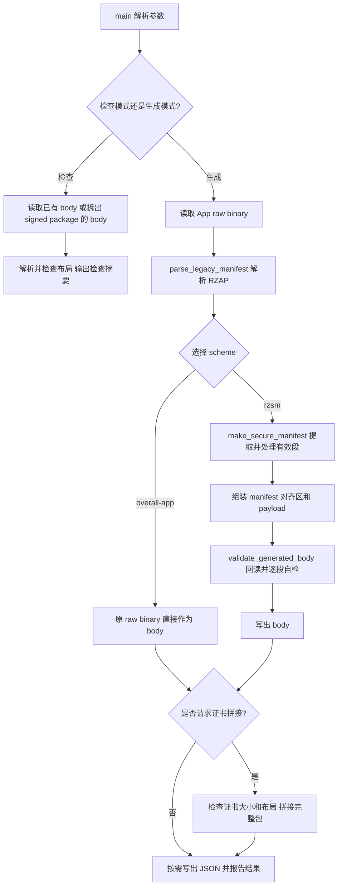

# make_secure_app_package.py 制包实现与原理

## 1. 先理解脚本处于哪一层

[make_secure_app_package.py](make_secure_app_package.py) 是一个**链接完成之后运行的主机端制包工具**。它读取已经生成的 PN2.0 App raw binary，根据其中的 RZAP manifest 提取段，转换为 Loader 能处理的 RZSM body，并按需要执行段级加密。

它不是编译器或链接器，也不是生成 Renesas 数字签名的工具。理解整个流程时，应区分以下四个阶段：

| 阶段 | 执行者 | 解决的问题 |
| --- | --- | --- |
| 编译与链接 | IAR App 工程 | 生成代码与数据，确定符号地址、运行地址和原始镜像布局 |
| 制包 | 本脚本 | 提取有效段，重排存储位置，生成 RZSM 和可选 AES-CBC 密文 |
| 原生签名 | Renesas `parameter_generator.py`、`secureboot_utility.py` | 生成参数及包含 Key Certificate、Code Certificate 的原生签名包 |
| 启动部署 | Secure SSBL Loader | 先认证完整包，再检查 RZSM，将段部署到运行地址并进入 App |

本文以当前默认 Scheme A，即 `--scheme rzsm`，作为主线。Scheme B 的 `--scheme overall-app` 在第 10 节对照说明。实际默认值以 `main()` 的参数定义为准，不应根据脚本顶部的历史 Scheme B 描述判断。

运行命令及烧录步骤见 [制包使用说明](make_secure_app_package.md)；Loader/App 分离的总体布局见 [Loader/App 分离说明](../README_loader_app_split.md)。本文不修改脚本、链接配置或固件，也不执行 Flash/OTP 操作。

## 2. 输入、输出与整体流程

### 2.1 输入和输出

| 对象 | 用途 |
| --- | --- |
| `--app-bin` | 已完成链接的 App raw binary，含 legacy RZAP |
| `--image-base` | 原 raw 镜像的链接基址，默认 `0x60100250` |
| `--app-manifest-offset` | RZAP 在 raw 文件中的偏移，默认 0 |
| `--aes-key` | 段加密所用的 16-byte 主机 AES key，必须对应板端 ckey0 |
| `--manifest-out` | 新生成的 RZSM manifest，不含段 payload |
| `--body-out` | 完整 RZSM body，是官方签名工具的输入 |
| `--summary-out` | JSON 记录，用于追踪地址、长度、IV、flags 和哈希 |
| `--key-cert`、`--code-cert` | 可选的已有证书，供拼接使用，不在本脚本中签发 |
| `--signed-package-out` | 可选的证书与 body 拼接结果 |

`--package-out` 是 `--body-out` 的旧别名；两个参数同时出现且路径不同会被拒绝。

### 2.2 主执行路径



这是职责流程图。实际写文件顺序存在一个重要细节：Scheme A 会先写 `manifest-out`，再组装和验证 body。因此报错时可能留下 manifest 或此前的输出，不应把“文件存在”视为本次制包已经全部成功。

## 3. 原 App 的链接信息从哪里来

### 3.1 RZAP 是链接器结果与制包工具之间的桥梁

App 和 Loader 是独立链接的工程，Loader 不能直接解析另一个工程的链接符号。App 因此在 [app_manifest.c](../RZN2L_bsp_xspi0bootx1_app/src/app_manifest.c) 中发布一个固定格式的 RZAP 结构。

IAR 链接器根据 App 的 [fsp_xspi0_boot_m.icf](../RZN2L_bsp_xspi0bootx1_app/script/fsp_xspi0_boot_m.icf) 解析以下信息：

- `src`：对应 `*_RBLOCK` 的起点，即初始化内容在原 ROM 镜像中的来源地址。
- `dst`：对应 `*_WBLOCK` 的起点，即段的最终运行地址。
- `size`：对应运行 block 的大小。
- `entry_point`：App `system_init` 的链接地址。

例如 LDR_PRG 的描述使用 `__section_begin("LDR_PRG_RBLOCK")`、`__section_begin("LDR_PRG_WBLOCK")` 和 `__section_size("LDR_PRG_WBLOCK")`。这些符号在 App 链接时解析为数值；脚本只是从 bin 中读取这些数值，不需要重新运行链接器。

```text
IAR 链接符号
    -> RZAP 中的 src / dst / size / entry_point
    -> Python 解析得到 LegacyManifest / LegacyEntry
    -> RZSM 中的 src_offset / dst_addr / file_size / entry_point
```

### 3.2 RZAP 的文件布局

RZAP header 使用小端格式 `<4I`，共 16 bytes，字段为 magic、entry_count、entry_point 和 reserved。每个 entry 同样为 `<4I`，共 16 bytes，包含 src、dst、size 和 flags。

`segment_id` 不在 legacy entry 中单独存储，而是由脚本按 entry 数组索引赋值。索引 0 至 8 依次对应 LDR_PRG、LDR_DATA、VECTOR、USER_PRG、USER_DATA、SYSTEM_PRG、SYSTEM_DATA、NONCACHE 和 SHARED_NONCACHE_BUFFER。

当前 App 定义九个 entry，RZAP 实际结构大小为 `16 + 9 * 16 = 160 = 0xA0` bytes。链接脚本为 `.app_manifest` 预留 `0x100` bytes，并把 LDR_PRG 的 ROM block 放在其后：

```text
原 App raw binary 的偏移
0x000 .. 0x09F   RZAP 结构，160 bytes
0x0A0 .. 0x0FF   剩余预留空间，96 bytes
0x100 起        LDR_PRG 的原始明文内容
```

这里的 `0x100` 是链接布局预留空间，不是 AES padding。链接脚本的证书地址偏移也不表示 raw 文件已经包含两份原生证书；证书在签名包层处理。

## 4. 地址转换：为什么能重排包，却不重新链接 App

### 4.1 必须区分四种位置

| 名称 | 含义 | 谁决定 |
| --- | --- | --- |
| 原来源地址 `src` | RZAP 内记录的原 ROM 链接来源地址 | App 链接器 |
| 原文件偏移 `image_offset` | 在 raw bin 中读取明文的位置 | `src - image_base` |
| 新 body 偏移 `src_offset` | 段在紧凑 RZSM body 中的位置 | 制包脚本 |
| 运行地址 `dst_addr` | Loader 将明文部署到哪里，App 在哪里使用它 | App 链接器，制包时保留 |

原 raw bin 是字节文件，不携带“文件自身的绝对地址”。因此脚本需要 `--image-base` 将 RZAP 的绝对来源地址换算为文件偏移。

```text
image_offset = legacy_entry.src - image_base
plaintext    = app_image[image_offset : image_offset + legacy_entry.size]
```

生成 RZSM 后，Loader 不再用 legacy `src` 读取段，而使用新 body 的相对偏移：

```text
runtime_flash_source = package_base + 0x200 + secure_entry.src_offset
runtime_destination  = secure_entry.dst_addr
```

默认 `package_base = 0x60100050`，两份证书合计 `0x200`，因此 `body_addr = 0x60100250`。

### 4.2 段 0 示例

以下以七个有效段、默认对齐的布局举例。LDR_PRG 的原来源地址为 `0x60100350`，raw 镜像链接基址为 `0x60100250`：

```text
原 raw 文件偏移 = 0x60100350 - 0x60100250 = 0x100
```

新 RZSM 的 header 为 64 bytes，七个 entry 各为 96 bytes，默认对齐后第一个 payload 从 `0x2E0` 开始：

```text
新 manifest 大小          = 64 + 7 * 96 = 0x2E0
段 0 的新 body 偏移       = 0x2E0
段 0 在完整包中的偏移     = 0x200 + 0x2E0 = 0x4E0
段 0 的新 Flash 密文地址  = 0x60100050 + 0x4E0 = 0x60100530
段 0 的最终运行地址       = 0x0011A000
```

因此同一段可以同时有 `raw offset=0x100` 和 `body offset=0x2E0`。它们不是矛盾，而是输入文件和输出文件的两个布局。

### 4.3 不重新链接的成立条件

脚本保留每段的明文内容、`dst_addr`、有效长度和 App 入口，仅改变加载前的存储布局。Loader 恢复并部署到原运行地址后，App 内已经解析的符号地址和指令引用仍成立。

这不是 Python 在执行二次链接，也不是给机器码打重定位补丁。它依赖 App 本来就是按这些 RAM 运行地址链接的多段部署镜像。

如果修改运行地址、段划分或 App 入口，就必须重新链接 App，并检查 Loader 的内存白名单与布局约束。若代码或 App startup 仍直接依赖旧 Flash 来源地址，也不能仅靠重排包保证正确；集成启动应避免重新执行旧来源的数据复制。

`--image-base` 和 `--package-base` 默认值恰好相差证书长度，但职责不同：前者解释输入，后者描述输出。更改 `--package-base` 不会自动重链接 App，也不会自动修改 Loader 的固定包地址。

## 5. `make_secure_manifest()` 的逐段处理

### 5.1 选择有效段

函数首先选出 `flags` 含 ENABLE 且 `size != 0` 的 legacy entry，保留原 entry 顺序。零长度和禁用段不进入 RZSM。

加密选择共有三种：

| 选择 | 处理 |
| --- | --- |
| 不指定加密选项 | 所有有效段保持明文 |
| `--encrypt-segment NAME_OR_ID` | 只加密指定的已知、启用且非空段 |
| `--encrypt-all` | 加密全部有效段，包含 ID 0 |

单段和全段选项互斥。加密必须提供 key；不选择加密而单独提供 key 也会被拒绝。密钥文件必须恰好为 16 bytes。

### 5.2 提取明文与计算哈希

对每个 entry，先计算 `image_offset`，拒绝来源低于 image base 或超出 raw 文件的情况，再切片取得完整原始明文。

SHA-256 针对**原始有效明文**计算，不包括 CBC 零 padding。摘要转换为八个小端 32-bit word；entry 序列化仍使用小端格式，保留摘要字节。

### 5.3 可选加密

加密段执行以下步骤：

1. 用 `os.urandom(16)` 生成 IV，遇到全零或本包内已使用的 IV 时重试。
2. 以零字节补齐明文到 16-byte 倍数，不使用 PKCS#7。
3. 使用 PyCryptodome 的 AES-128-CBC 生成 payload 密文。
4. 设置 ENCRYPTED 标志、`cipher_size`、CKEY0 选择值和 IV。

`encrypt_aes_128_cbc()` 本身不添加 padding；padding 是调用它之前在 `make_secure_manifest()` 中完成的。明文段使用零 IV、NONE 密钥选择，并令 `cipher_size = file_size`。

### 5.4 紧凑排列 payload

在写入每段之前，将当前 payload 长度补齐到 4-byte 边界。该段在 body 中的来源偏移为：

```text
src_offset = payload_offset + current_payload_length
```

随后追加该段的明文或密文。段间对齐只增加必要的零字节，不保留 raw 文件中不同段之间的大块地址空洞。单个段内部的原始字节则保持完整。

所有段处理完后，再将 payload 总长度以零字节补齐到 16-byte 倍数。`payload_size` 包含段数据、段间对齐和最后的补齐；它不一定等于所有 `file_size` 相加。

### 5.5 新 entry 保留和新增的信息

| 字段 | 来源/含义 |
| --- | --- |
| `segment_id` | legacy 数组索引，不能因紧凑排列而重新编号 |
| `flags` | 明文为 ENABLE + HASH_VALID，即 `0x09`；加密再加 ENCRYPTED，即 `0x0B` |
| `src_offset` | 新生成的 body 相对偏移 |
| `dst_addr` | 保留 legacy `dst` |
| `file_size`、`mem_size` | 都保留 legacy `size`，不额外生成 BSS 清零段 |
| `load_attr` | 当前写 0 |
| `cipher_size` | 明文长度或补齐后的密文长度 |
| `aes_key_selection` | NONE=0 或 CKEY0=1 |
| `aes_cbc_iv` | 16-byte IV；明文段全零 |
| `sha256_words` | 原始有效明文的 SHA-256 |
| `reserved_words` | 当前三个 word 全为 0 |

Entry 用 `<9I16s8I3I` 序列化，共 `36 + 16 + 32 + 12 = 96` bytes。

## 6. Header、CRC 和三类 padding

### 6.1 Header 长度关系

```text
manifest_size = 64 + segment_count * 96
payload_offset = align_up(manifest_size, alignment)
payload_size = length_of_final_payload_buffer
package_size = payload_offset + payload_size
signed_region_offset = 0
signed_region_size = package_size
```

Header 用 `<16I` 序列化，magic 为 `0x4D535A52`，版本为 `0x00020000`。它还记录包版本、flags、App 入口、原 image base 和 legacy manifest offset。

`image_base_addr` 与 `app_manifest_offset` 用于追踪制包输入；Scheme A Loader 部署时的权威来源仍是每个 entry 的 `src_offset`，不再按 legacy 地址推导。

### 6.2 CRC 的计算范围

生成时先把 header 的 CRC 字段设为 0，再计算：

```text
CRC32 = crc32(header_with_zero_crc + all_serialized_entries)
```

随后把 CRC 写入 header 最后一个 word。检查时也将该字段清零再重算。CRC 不覆盖 manifest 后面的对齐区或段 payload，它用于格式/损坏检查，不能代替密码学签名。

### 6.3 不同 padding 不能混淆

| 位置 | 填充值 | 对齐目标 | 是否属于有效运行明文 |
| --- | --- | --- | --- |
| manifest 与 payload 起点之间 | `0xFF` | `--align`，默认 16 | 否 |
| 每个加密段的明文末尾 | `0x00` | AES 16-byte block | 否；Loader 只写 `file_size` bytes |
| payload 内段间间隙及 payload 最后 | `0x00` | 段起点 4-byte，payload 总长 16-byte | 否 |

默认 `--align 16` 时，整个 body 长度为 16-byte 倍数，避免官方工具额外改变 body 长度。不要把该结论无条件推广到任意自定义 `--align`；修改对齐时还要确认源偏移四字节对齐及最终原生 image 长度匹配。

## 7. 生成后自检为什么必要

`main()` 在写出 body 前调用 `validate_generated_body()`，用脚本自己的解析器重新读取生成结果，而不是只相信前面的构造过程。

### 7.1 第一层：格式与 CRC

`parse_secure_manifest()` 检查 magic、版本、header 大小、entry 数量、manifest 大小、body 总长、payload 关系、完整 signed region 和 CRC。

脚本当前接受的 entry 数量上限来自 PN2.0 RZAP 的九段 ABI；这与 Loader 的结构容纳上限不是同一个概念。

### 7.2 第二层：payload 布局

`validate_secure_manifest_layout()` 检查段 ID 不重复、每段启用且明文长度有效、来源四字节对齐、不超出 body、加密 metadata 合法，以及按来源范围排序后没有 payload 重叠。

加密段还检查已知 ID、目标四字节对齐、CKEY0、密文长度、非零 IV 和 IV 不重复。

这不是 Loader 目标内存白名单校验。主机这层主要检查制包来源布局；板端仍须按自己的运行内存窗口校验目标范围及重叠。

### 7.3 第三层：与原 App 一致

`validate_generated_body()` 再次解析原 RZAP，检查 entry_point、有效段数量、段 ID、目标地址和长度都与原输入匹配，并逐段验证：

- RZSM 内的 SHA-256 与原始有效明文一致。
- 明文 payload 与原 raw 段逐字节相同。
- 加密 payload 用同一 host key 解密后，有效明文逐字节相同，尾部 padding 全为零。

因此自检能发现字段、偏移、内容及加密往返不一致，但它不能证明 host key 与真实 OTP ckey0 相同，也没有验证 Renesas ECDSA 签名。

## 8. 证书“拼接”与数字签名的区别

### 8.1 本脚本的拼接能力

同时提供 `--key-cert`、`--code-cert` 和 `--signed-package-out` 时，脚本读取已有证书并输出：

```text
signed_package = key_certificate + code_certificate + body
```

Key Certificate 必须为 `0xE0` bytes，Code Certificate 必须为 `0x120` bytes，两者合计 `0x200`。这一步是字节拼接，不是生成签名。

默认的 `validate_code_cert_layout()` 只检查：

```text
Code Certificate dest_addr == package_base + 0x200
Code Certificate img_size  == len(body)
```

`dest_addr` 是地址，`img_size` 是长度，不能混用。`--no-cert-layout-check` 仅跳过这两个布局检查，不会让旧签名自动适配新 body。

### 8.2 推荐的签名衔接


官方工具必须消费**完整 body**，不是只消费 `manifest-out`。当前 App 外层使用 `cert-img`，不添加外层 `--enckey`，否则 Loader 认证之后仍不能直接读取 RZSM header。段级密文已经包含在 body 内。

对于加密包，每次重新生成 body 都会产生新的随机 IV，通常得到不同的密文和 body 哈希。因此不能取旧包的证书，机械拼接到重新生成的 body 上；即使地址、长度检查通过，签名仍可能完全不匹配。

本脚本也不使用 Root/Image PEM 私钥。签名私钥由官方工具使用；AES host key、签名私钥均不作为 payload 放进 App 包。

## 9. 检查模式与 JSON 追踪

### 9.1 inspect 能检查什么

`--inspect-body` 读取已有 body；`--inspect-signed-package` 先将前 `0x200` bytes 分成两份证书，再解析剩余 body。两者互斥，且不能与制包输出或段加密选项混用。

Scheme A 检查模式会检查 RZSM CRC、长度和 payload 布局；存在 Code Certificate 时也检查上述地址和长度关系。它不需要 host AES key，也不会解密已有密文、不比较每段原始明文，更不会验证证书签名。

因此 `inspect ok` 表示格式与相关布局检查通过，不能写成“密码学验签通过”或“板端部署成功”。

### 9.2 JSON 中几个容易混淆的字段

| JSON 字段 | 正确理解 |
| --- | --- |
| 段 `src` | legacy RZAP 的原链接来源地址，不是重排后的 Flash 来源 |
| 段 `image_offset` | 段在原 raw 文件中的偏移 |
| 段 `src_offset_in_body` | 新 body 中的权威偏移 |
| 段 `dst` | 保留的运行地址 |
| 段 `size` 与 `cipher_size` | 有效明文长度与实际存储 payload 长度 |
| `layout.body_addr` | 完整包基址加两份证书长度 |
| `app_image_sha256` | 完整输入 raw bin 的哈希 |
| `body_sha256` | 完整输出 body 的哈希，包含 metadata、对齐和 payload |
| `signed_package.sha256` | 仅在拼接输出包含证书时记录完整拼接包哈希 |

IV 可以写入 JSON 和认证后的 manifest；它不是 AES key。摘要输出是追踪记录，不是验证通过的签名证明。

## 10. Scheme A 与 Scheme B 的制包差别

| 对比项 | Scheme A：`rzsm` | Scheme B：`overall-app` |
| --- | --- | --- |
| body | 新 RZSM + 对齐 + 紧凑段 payload | 原 App raw binary 原样保留 |
| manifest | 64-byte header + 96-byte entry 的 RZSM v2 | 原 legacy RZAP |
| 段来源 | 新 body 相对 `src_offset` | 原 raw 布局，按链接基址解释来源 |
| 段级 AES | 支持无加密、单段或全段 | 当前 CLI 拒绝段加密选项 |
| 原文件空洞 | 不保留不同有效段之间的大块空洞 | 作为 raw 文件内容保留 |
| 原生签名范围 | 完整新 body | 完整原 raw body |

两种 scheme 都不重新链接 App，但 Loader 必须使用与 body 格式匹配的部署路径。不能用旧 Scheme B 读取逻辑解释 Scheme A 的 RZSM。

## 11. 关键函数速查

| 函数 | 在制包逻辑中的职责 |
| --- | --- |
| `main()` | 参数分支、读取输入、组织生成/检查/输出 |
| `parse_legacy_manifest()` | 从 raw 指定偏移读取 RZAP，并以数组索引确定段 ID |
| `parse_segment_id()` | 将段名或数字转换为 ID |
| `align_up()` | 正数对齐计算，供 manifest/payload/AES 补齐使用 |
| `make_secure_manifest()` | 有效段选择、明文提取、SHA、加密、偏移分配、序列化和 CRC |
| `encrypt_aes_128_cbc()`、`decrypt_aes_128_cbc()` | AES 原语封装，要求输入长度已满足 block 条件 |
| `parse_secure_manifest()` | 回读 RZSM 并检查 header、长度和 CRC |
| `validate_secure_manifest_layout()` | 检查 entry 和来源 payload 布局 |
| `validate_generated_body()` | 对照原 App 做完整制包自检，包括 AES 往返 |
| `read_fixed_size()` | 检查 host key 或证书文件的固定长度 |
| `parse_code_cert_header()`、`validate_code_cert_layout()` | 读取原生证书头并比较地址/长度，不执行 ECDSA 验签 |
| `inspect_package_body()`、`inspect_overall_app_body()` | 检查已有 Scheme A/B body，输出检查结果 |
| `write_json_summary()`、`write_overall_app_json_summary()` | 生成 Scheme A/B 追踪记录 |
| `resolve_body_out()` | 处理新旧 body 输出参数的兼容性 |

## 12. 与 Loader 配合的关键约束

1. App 必须先正确链接；脚本不能替代缺失或错误的链接布局。
2. RZSM 的 entry 编号、字段大小和 flags 必须与 Loader ABI 一致。
3. `package_base`、证书长度、body 地址必须与 Loader 固定布局一致；当前 App 包从 `0x60100050` 开始，body 从 `0x60100250` 开始。
4. Loader 必须先验签再使用地址、长度、IV 和入口；主机 CRC 与自检不能取代这一安全顺序。
5. Loader 必须将零 padding 排除在运行区写入范围之外，尤其是 SYSTEM_DATA 与 SYSTEM_PRG 紧邻时。
6. App 集成 startup 不应再按旧 Flash 来源重复复制已由 SSBL 部署的数据；相关 `APP_STANDALONE_DEBUG` 处理见 [App startup](../RZN2L_bsp_xspi0bootx1_app/src/fsp_mod/startup.c)。
7. 当前 Loader 没有逐段重算明文 SHA-256，也没有仅凭 `package_version` 实现防回滚；不要从字段存在推导出尚未实现的功能。
8. 仓库中的 `secureboot_common_key.bin` 是已经公开的 demo key，仅限测试，不能用于生产设备。

## 13. 小结

脚本的设计可以概括为：**保留链接器确定的运行布局，重新组织加载前的存储布局，并为这个新布局建立可认证的 manifest 和 body。**

RZAP 告诉脚本“原明文在哪里、运行时要放在哪里”；RZSM 告诉 Loader“新包里在哪里、怎样恢复、恢复到哪里”。原生签名将这些 metadata 与 payload 绑定为完整认证对象，Loader 再按白名单约束进行部署。各阶段的边界清晰，才能避免把文件偏移、Flash 地址、运行地址和签名能力混为一谈。
