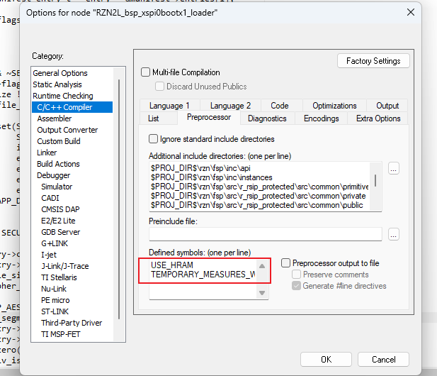
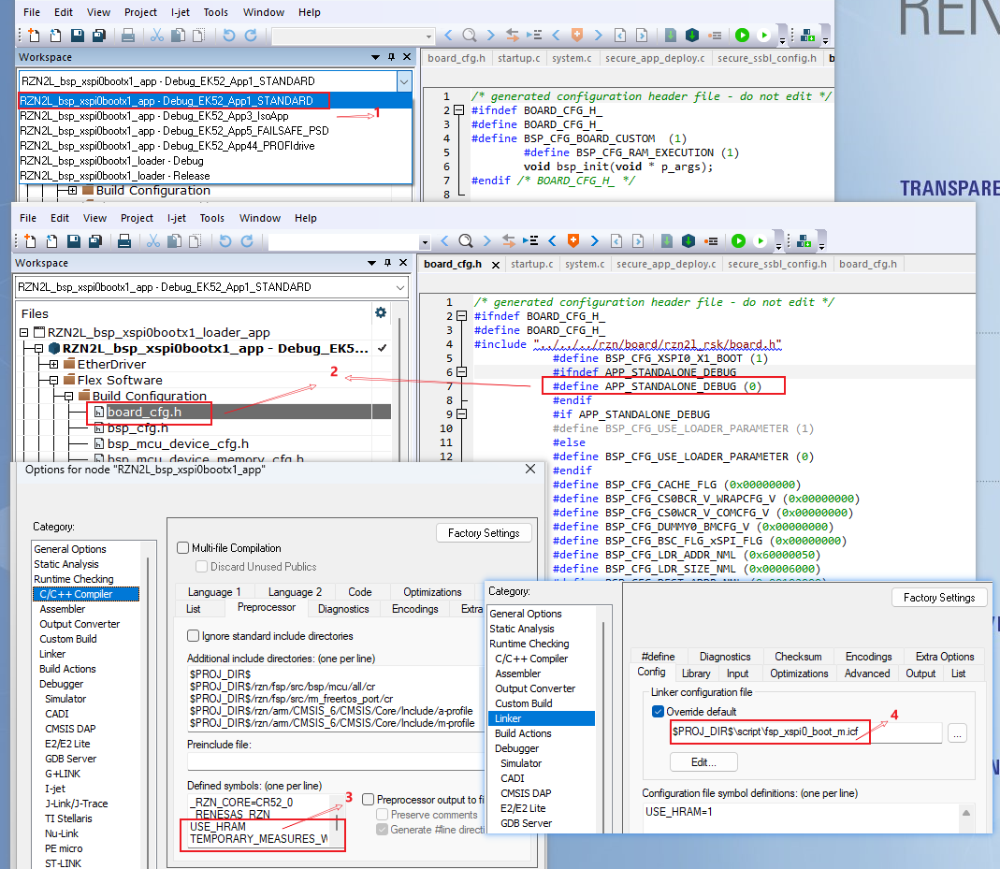

# RZN2L PN2.0 Secure Boot Guide Line

本文只列操作步骤和每步输出。主线为 **HyperRAM、加密并签名 Loader、全段加密并签名 App**。

适用环境：IAR EWARM 9.70.2、Python 3.12、windows powershell、原发布例程配套的 Renesas 6526/6527 Python 工具。SDRAM 配置尚未完成 socket board 板端验证。

**工程配置前提：**在 IAR 环境中正确编译 Loader 和 App 工程之前，必须先按照 [README_loader_app_split.md](../README_loader_app_split.md) 完成两个工程的配置和相关依赖。本 Guide 的步骤 3、4 以工程已正确配置为前提，不替代该 README 中的工程配置流程。

前置条件：RZN2L RSK socket Board 已完成安全配置；签名密钥和 AES host key 必须与这块板卡匹配。本例使用与已验证实验板 OTP ckey0 对应的 AES-128 key。若其他板卡的 ckey0 不同，应使用与该板卡已配置 ckey0 匹配的 host key，或使用已配置本例密钥的实验板；不要为运行本 Guide 重写 OTP。新板 provisioning 应另行按 Renesas 原生例程 6526 审核执行。本文不包含 OTP 写入、Secure Boot enable 或 SCI/USB Boot disable 操作。仓库公开 AES key 仅供 demo，不用于量产。

从步骤 1 开始按顺序执行；每个代码块整体执行，出现错误立即停止，不继续使用旧输出。

## 1. 准备统一工具目录

1. 获取 [Scheme A 工程](https://github.com/RENESAS-EPAE3-TEAM/rzn2l-pn200-secure-boot-firmware-update/tree/main)。
2. 保留工程中的 tools 目录下的[make_secure_app_package.py](make_secure_app_package.py)。
3. 将原发布例程配套 `Secure device setup` 的工具脚本、运行依赖及 Device Setup Program 下载文件（`.srec`，见下方说明）放到 `tools/renesas_secureboot`，保持原目录结构；不要只复制三个 Python 文件。
4. 将与板卡匹配的签名私钥单独放到本机目录，例如 `C:\SecureBootKeys`；本例 AES demo key 使用 `tools/secureboot_common_key.bin`。不要生成新密钥替换已配置板卡的密钥；正式密钥不得放入待发布目录。

**`.srec` 文件说明：**S-record 是一种以文本记录程序数据和加载地址的文件格式。本 Guide 具体使用 `RZN2L_RSK_SecureDeviceSetup_SCI_qspi.out.srec`，即官方例程提供的 Device Setup Program 下载文件，从配套 `Secure device setup/rzn2l` 目录获取，无须由本工程编译生成。

步骤 12 的 `secure_device_setup.py start` 会通过 SCI 将该程序下载到板端 RAM 并运行，为后续 Flash 写入提供服务。它不是 Loader/App binary，也不是后续三条 `writeflash` 命令要写入 Flash 的文件。

**完成后的目录：**

```text
iar_project/
  RZN2L_bsp_xspi0bootx1_loader_app.eww
  tools/
    rzn2l_PN20_Secure_Boot_Guide_Line_cn.md
    make_secure_app_package.py
    renesas_secureboot/
      pn20_secure_ssbl/
        parameter_generator.py
        secureboot_utility.py
        secure_device_setup.py
        ...原工具的运行依赖...
      rzn2l/
        RZN2L_RSK_SecureDeviceSetup_SCI_qspi.out.srec
    scheme_a_output/          本次生成的所有输出
```

若原工具的脚本目录不叫 `pn20_secure_ssbl`，将下一步的 `$toolDir` 改成实际目录，并保留其运行依赖。

**输出：**工程、Python 工具和本 Guide 均位于同一个工程目录；AES demo key 位于 `tools/secureboot_common_key.bin`，签名私钥在工程目录外保存。

## 2. 设置 PowerShell 环境

在工程根目录打开 PowerShell。先修改 `$keyDir`，必要时修改 `$python` 和 `$toolDir`。若板卡不使用本例 demo key，将 `$aesKey` 改为与该板卡 ckey0 匹配的 host key 路径。以下变量在整个流程中共用，不要中途更换终端。

```powershell
$workspace = (Get-Location).Path
$python = (Get-Command python -ErrorAction Stop).Source
$tools = Join-Path $workspace 'tools'
$toolRoot = Join-Path $tools 'renesas_secureboot'
$toolDir = Join-Path $toolRoot 'pn20_secure_ssbl'
$keyDir = 'C:\SecureBootKeys'
$rootKey = Join-Path $keyDir 'rootkey-pair.pem'
$imageKey = Join-Path $keyDir 'loaderkey-pair.pem'
$aesKey = Join-Path $tools 'secureboot_common_key.bin'
$outDir = Join-Path $tools 'scheme_a_output'
$loaderRaw = Join-Path $workspace 'RZN2L_bsp_xspi0bootx1_loader\Debug\Exe\RZN2L_bsp_xspi0bootx1_loader.bin'
$appRaw = Join-Path $workspace 'RZN2L_bsp_xspi0bootx1_app\Debug_EK52_App1_STANDARD\Exe\RZN2L_bsp_xspi0bootx1_app.bin'
$padded = Join-Path $outDir 'loader_padded.bin'
$loaderParam = Join-Path $outDir 'loader_parameter_xspi0.bin'
$ssbl = Join-Path $outDir 'secure_ssbl_xspi0.bin'
$appInput = Join-Path $outDir 'app_raw.bin'
$manifest = Join-Path $outDir 'app_manifest.bin'
$body = Join-Path $outDir 'app_body.bin'
$appSummary = Join-Path $outDir 'app_summary.json'
$appParam = Join-Path $outDir 'app_parameter.bin'
$appPackage = Join-Path $outDir 'secure_app_package.bin'

& {
    foreach ($path in @("$toolDir\parameter_generator.py", "$toolDir\secureboot_utility.py",
        "$toolDir\secure_device_setup.py", "$tools\make_secure_app_package.py", $rootKey, $imageKey, $aesKey)) {
        if (-not (Test-Path -LiteralPath $path)) { throw "Missing input: $path" }
    }
    if ([IO.File]::ReadAllBytes($aesKey).Length -ne 16) { throw 'Expected a 16-byte AES key' }
    & $python --version
    if ($LASTEXITCODE -ne 0) { throw 'Python check failed' }
    & $python -m pip install pycryptodome
    if ($LASTEXITCODE -ne 0) { throw 'PyCryptodome installation failed' }
    New-Item -ItemType Directory -Force -Path $outDir | Out-Null
    Set-Location $outDir
}
```

按官方工具手册安装官方脚本所需的其他 Python 依赖。官方签名日志和 `.pubkey` 输出到当前工作目录；后续保持工作目录为 `$outDir`。

**输出：**Python 版本、依赖安装成功提示，以及 `tools/scheme_a_output` 目录。

**可选：复用发布版本 raw binary。**若未修改源码，可跳过步骤 3、4，先执行下面的路径设置，再从步骤 5 继续。不要用已签名包或 padded Loader 替代 raw binary。

```powershell
$loaderRaw = Join-Path $tools 'RZN2L_bsp_xspi0bootx1_loader.bin'
$appRaw = Join-Path $tools 'RZN2L_bsp_xspi0bootx1_app.bin'
Get-Item $loaderRaw, $appRaw | Select-Object FullName, Length, LastWriteTime
```

## 3. 手动编译 Loader

1. 在 IAR 打开 [Loader/App workspace](../RZN2L_bsp_xspi0bootx1_loader_app.eww)。
2. 选择 Loader 工程，配置选 `Debug`。
3. 核对该配置包含 `USE_HRAM`；

4. 执行 **Project > Rebuild All**，确认无编译/链接错误。

**输出：**

```text
RZN2L_bsp_xspi0bootx1_loader/Debug/Exe/RZN2L_bsp_xspi0bootx1_loader.bin
RZN2L_bsp_xspi0bootx1_loader/Debug/Exe/RZN2L_bsp_xspi0bootx1_loader.out
```

若没有 `.bin`，核对发布工程的 Output Converter 是否生成 Binary；不要用旧 `.bin` 继续制包。

## 4. 手动编译 App

1. 选择 App 工程，配置选 `Debug_EK52_App1_STANDARD`，与 Loader 同样使用 `USE_HRAM`。
2. 核对 App 链接配置：已验证配置使用 `script/fsp_xspi0_boot_m.icf`，保留 `.app_manifest` 固定区域和 App BTCM 偏移。若当前工程选择原始 `fsp_xspi0_boot.icf` 且没有这些布局，先人工确认/恢复发布版本配置，再编译；本 Guide 不修改 IAR 设置。
3. 确认集成启动采用 `APP_STANDALONE_DEBUG=0`。

4. 执行 **Project > Rebuild All**，确认无编译/链接错误。

**输出：**

```text
RZN2L_bsp_xspi0bootx1_app/Debug_EK52_App1_STANDARD/Exe/RZN2L_bsp_xspi0bootx1_app.bin
RZN2L_bsp_xspi0bootx1_app/Debug_EK52_App1_STANDARD/Exe/RZN2L_bsp_xspi0bootx1_app.out
```

确认两份 `.bin` 的修改时间属于本次构建：

```powershell
Get-Item $loaderRaw, $appRaw | Select-Object FullName, Length, LastWriteTime
```

**输出：**本次 Loader/App binary 的路径、长度和修改时间。

## 5. 归档 raw binary 并补齐 Loader

```powershell
& {
    $appBytes = [IO.File]::ReadAllBytes($appRaw)
    if ($appBytes.Length -lt 16 -or [BitConverter]::ToUInt32($appBytes, 0) -ne 0x50415A52) {
        throw 'App raw binary does not start with RZAP; check the Scheme A linker configuration'
    }
    Copy-Item -LiteralPath $loaderRaw -Destination (Join-Path $outDir 'loader_raw.bin')
    Copy-Item -LiteralPath $appRaw -Destination $appInput
    $rawBytes = [IO.File]::ReadAllBytes((Join-Path $outDir 'loader_raw.bin'))
    if ($rawBytes.Length -eq 0) { throw 'Loader raw binary is empty' }
    $paddedSize = [int]([Math]::Ceiling($rawBytes.Length / 512.0) * 512)
    $paddedBytes = [byte[]]::new($paddedSize)
    for ($index = 0; $index -lt $paddedSize; $index++) { $paddedBytes[$index] = 0xFF }
    [Array]::Copy($rawBytes, $paddedBytes, $rawBytes.Length)
    [IO.File]::WriteAllBytes($padded, $paddedBytes)
    'Loader raw={0}, padded={1}' -f $rawBytes.Length, $paddedSize
}
```

**输出：**`loader_raw.bin`、`app_raw.bin`、`loader_padded.bin`。Padded 长度为 512-byte 倍数；长度按本次构建计算，不使用历史固定值。

## 6. 生成 Loader parameter

```powershell
& {
    & $python "$toolDir\parameter_generator.py" loader `
      --mpu rzn2l --target_cpu cr52 `
      --src_addr 60000050 --dest_addr 00102000 `
      --mode xspi0 --secureboot -i $padded -o $loaderParam
    if ($LASTEXITCODE -ne 0) { throw 'Loader parameter generation failed' }
}
```

**输出：**`loader_parameter_xspi0.bin`，当前工具输出为 76 bytes。工具提示 Loader 程序地址为 `0x00102800` 属正常提示，应与 Loader Map 一致。

## 7. 加密并签名 Loader

```powershell
& {
    & $python "$toolDir\secureboot_utility.py" image `
      -i $padded -o $ssbl --param $loaderParam `
      --rkey $rootKey --ikey $imageKey `
      --enckey $aesKey --keyselect ckey0 --sign_target cert-img --ver 0
    if ($LASTEXITCODE -ne 0) { throw 'Encrypted SSBL generation failed' }
}
```

**输出：**`secure_ssbl_xspi0.bin`、`secure_ssbl_xspi0.log`、`secure_ssbl_xspi0.pubkey`。

**检查结果：**日志包含 `cert-img`、`Image encryption: Enable`、`Key select: ckey0`；完整 SSBL 长度为 padded Loader 长度加 `0x800`。

## 8. 生成全段加密 App body

使用 `--encrypt-all` 加密全部启用且非空的 App 段；当前标准 App 为七段。

```powershell
& {
    & $python "$tools\make_secure_app_package.py" --scheme rzsm `
      --app-bin $appInput --image-base 0x60100250 --package-base 0x60100050 `
      --manifest-out $manifest --body-out $body --align 16 `
    --encrypt-all --aes-key $aesKey --summary-out $appSummary
    if ($LASTEXITCODE -ne 0) { throw 'App body generation failed' }
}
```

**输出：**`app_manifest.bin`、`app_body.bin`、`app_summary.json`。控制台显示段数量和入口；当前标准配置为七段、入口 `0x0011A000`。必须命令成功才继续。

每次重新执行本步骤，必须继续重新执行步骤 9、10，不能复用旧 App 签名包。

可选：若只需 App 签名、不加密，删除本命令中的 `--encrypt-all --aes-key $aesKey`，其余步骤不变；步骤 7 的 Loader 仍为加密并签名版本。

## 9. 生成 App parameter

```powershell
& {
    & $python "$toolDir\parameter_generator.py" userapp `
      --src_addr 60100050 --app_start_addr 60100250 `
      --secureboot -i $body -o $appParam
    if ($LASTEXITCODE -ne 0) { throw 'App parameter generation failed' }
}
```

**输出：**`app_parameter.bin`。输入必须是完整 `app_body.bin`，不是 `app_manifest.bin`。

## 10. 签名 App，生成完整 package

```powershell
& {
    & $python "$toolDir\secureboot_utility.py" image `
      -i $body -o $appPackage --param $appParam `
      --rkey $rootKey --ikey $imageKey --sign_target cert-img --ver 0
    if ($LASTEXITCODE -ne 0) { throw 'App signing failed' }
}
```

**输出：**`secure_app_package.bin`、`secure_app_package.log`、`secure_app_package.pubkey`。完整 App package 长度为 body 长度加 `0x200`。

**检查结果：**日志包含 `cert-img` 和 `Image encryption: Disable`。本步骤不要加 `--enckey`；步骤 8 已完成全部有效段的加密，外层不再重复加密。

## 11. 检查产物

```powershell
& {
    & $python "$tools\make_secure_app_package.py" --scheme rzsm `
      --inspect-signed-package $appPackage --package-base 0x60100050 `
      --summary-out (Join-Path $outDir 'app_inspect.json')
    if ($LASTEXITCODE -ne 0) { throw 'App package inspection failed' }
    $ssblPubkey = Get-FileHash (Join-Path $outDir 'secure_ssbl_xspi0.pubkey')
    $appPubkey = Get-FileHash (Join-Path $outDir 'secure_app_package.pubkey')
    if ($ssblPubkey.Hash -ne $appPubkey.Hash) { throw 'SSBL/App public-key identity mismatch' }
    if ((Get-Item $ssbl).Length -ne (Get-Item $padded).Length + 0x800) { throw 'SSBL length mismatch' }
    if ((Get-Item $appPackage).Length -ne (Get-Item $body).Length + 0x200) { throw 'App package length mismatch' }
    Get-Content (Join-Path $outDir 'secure_ssbl_xspi0.log')
    Get-Content (Join-Path $outDir 'secure_app_package.log')
    $summary = Get-Content $appSummary -Raw | ConvertFrom-Json
    $summary.segments | Select-Object segment_id, name, flags, size, cipher_size
    Get-Item $loaderParam, $ssbl, $appPackage | Select-Object Name, Length
    Get-FileHash $loaderParam, $ssbl, $appPackage |
        Export-Csv -NoTypeInformation -Encoding UTF8 (Join-Path $outDir 'flash_files_sha256.csv')
}
```

**输出：**`inspect ok`、`app_inspect.json`、三份烧录文件的长度、`flash_files_sha256.csv`。

**检查结果：**全段加密时各有效段 flags 均为 `0x0000000B`；若使用步骤 8 的 App 仅签名选项，则均为 `0x00000009`。两份 `.pubkey` 哈希相同，且沿用已验证板卡密钥链。`inspect ok` 仅表示结构检查通过，不是密码学验签通过。

## 12. 写入 Flash 并验收启动

本步骤由板端操作人员执行。先关闭占用烧录串口的程序，按板卡手册切换 SCI Boot，复位/上电；将 `$COM` 改成实际端口。只对已完成安全配置的板卡执行，不写 OTP。

```powershell
$COM = 'COM3'
$setupSrec = Join-Path $toolRoot 'rzn2l\RZN2L_RSK_SecureDeviceSetup_SCI_qspi.out.srec'

& {
    & $python "$toolDir\secure_device_setup.py" start `
      --port $COM --boot_mode sci -i $setupSrec
    if ($LASTEXITCODE -ne 0) { throw 'Device Setup Program start failed' }
}
```

**输出：**Device Setup Program 下载并启动成功提示。失败则停止，检查端口和启动模式。

依次写入，每条成功才继续：

```powershell
& {
    & $python "$toolDir\secure_device_setup.py" writeflash --port $COM --addr 60000000 -i $loaderParam
    if ($LASTEXITCODE -ne 0) { throw 'Loader parameter write failed' }
    & $python "$toolDir\secure_device_setup.py" writeflash --port $COM --addr 60000050 -i $ssbl
    if ($LASTEXITCODE -ne 0) { throw 'SSBL write failed' }
    & $python "$toolDir\secure_device_setup.py" writeflash --port $COM --addr 60100050 -i $appPackage
    if ($LASTEXITCODE -ne 0) { throw 'App package write failed' }
}
```

**输出：**三次 Flash write 成功提示，写入对象如下：

| Flash 地址 | 文件 |
| --- | --- |
| `60000000` | `loader_parameter_xspi0.bin` |
| `60000050` | `secure_ssbl_xspi0.bin` |
| `60100050` | `secure_app_package.bin` |

不要单独烧录 App parameter、manifest、body 或 raw binary。

切回正常 xSPI Startup Mode，打开对应调试 UART（115200、8N1、无流控），断电重上电，保存串口日志。

**预期输出顺序：**

```text
[SSBL] secure package verify start
[SSBL][VERIFY][OK] result=0 ...
[SSBL][RZSM] ... segments=7 ...
[SSBL] secure package deploy start
[SSBL][DEPLOY][OK] result=0 ...
[SSBL] jump app=0x0011a000
App 启动日志及正常业务运行
```

日志中的大小写/前导零以实际输出为准。只有 jump 日志不算 App 启动成功；必须确认 App 实际运行，且无 VERIFY/DEPLOY/RSIP CLOSE 失败。

**输出：**本次上板 UART 日志和 App 运行结果。日志归档到 `scheme_a_output`，不以本 Guide 的生成代替板级验证。

## 13. 交付成果目录

将本 Guide、`make_secure_app_package.py`、官方工具脚本及依赖目录、`scheme_a_output` 的本次产物一并交付。官方工具遵守原发布例程的使用许可；不包含签名私钥或正式 AES key。

`scheme_a_output` 应包含：

| 文件 | 来源步骤 | 用途 |
| --- | --- | --- |
| `loader_raw.bin`、`loader_padded.bin` | 5 | 本次 Loader 输入归档 |
| `loader_parameter_xspi0.bin` | 6 | 烧录文件 1 |
| `secure_ssbl_xspi0.bin`、对应 `.log`/`.pubkey` | 7 | 烧录文件 2 及生成记录 |
| `app_raw.bin` | 5 | 本次 App 输入归档 |
| `app_manifest.bin`、`app_body.bin`、`app_summary.json` | 8 | App 制包记录 |
| `app_parameter.bin` | 9 | App 签名参数，不单独烧录 |
| `secure_app_package.bin`、对应 `.log`/`.pubkey` | 10 | 烧录文件 3 及生成记录 |
| `app_inspect.json`、`flash_files_sha256.csv` | 11 | 结构检查和文件哈希记录 |
| 本次板端 UART 日志 | 12 | 上板验收记录 |
